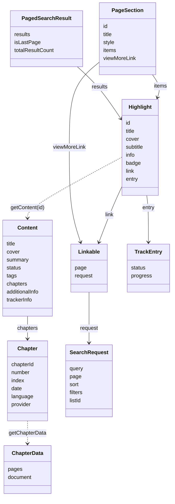

# Data model

Every type a source sends or receives, from `@mana-app/types`. `?` marks optional fields. Dates you return are sent as ISO 8601 strings.



## Source

### SourceInfo

```ts
type SourceInfo = {
  id: string;
  name: string;
  version: string;                         // semantic version
  website?: string;                        // required by Mana
  description?: string;
  developers?: { name: string; avatarUrl?: string; website?: string; github?: string }[];
  rating?: CatalogRating;
  supportedLanguages?: string[];
  thumbnail?: string;                      // assets/ file name or URL
  badges?: string[];
  minSupportedAppVersion?: string;
};
```

### SourceConfig

```ts
type SourceConfig = {
  disableUpdateChecks?: boolean;
  cloudflareResolutionURL?: string;
  allowsMultipleInstances?: boolean;
  owningLinks?: string[];
  requiresAuthenticationToAccessContent?: boolean;
};
```

### SourceContext

Passed to `getContent` and in `SearchRequest.context`.

```ts
type SourceContext = {
  origin?: SourceContextOrigin;                       // MIGRATION
  allowedContentRatings?: readonly ContentRating[];
};
```

## Titles

### Highlight

A title tile in search results, pages and links.

```ts
type Highlight = {
  id: string;                     // content ID passed to getContent
  title: string;
  cover: string;
  subtitle?: string;
  contentRating?: ContentRating;
  webUrl?: string;
  info?: { key: string; value: string }[];
  badge?: { text: string };
  link?: Linkable;                // open a page or search instead of the profile
  noninteractive?: boolean;
  entry?: TrackEntry;             // tracker pages only
  context?: SourceContext;
};
```

### Content

```ts
type Content = {
  title: string;
  cover: string;
  contentRating?: ContentRating;
  webUrl?: string;
  status?: PublicationStatus;                  // default: unknown
  summary?: string;
  additionalCovers?: string[];
  additionalTitles?: string[];
  tags?: Tag[];
  contentType?: ContentType;                   // default: unknown
  recommendedPanelMode?: ReadingMode;          // default: PAGED_COMIC
  additionalInfo?: AdditionalInfoSection[];
  trackerInfo?: Record<string, string>;        // { anilist: "21" }
  chapters?: Chapter[];                        // skips getChapters when set
};

type Tag = {
  id: string;
  title: string;
  contentRating?: ContentRating;
  image?: string;
  isNonInteractive?: boolean;
};
```

### AdditionalInfoSection

```ts
type AdditionalInfoSection =
  | { type: AdditionalInfoType.Staff;      id: string; title: string; hasMore: boolean; items: StaffItem[] }
  | { type: AdditionalInfoType.Highlights; id: string; title: string; hasMore: boolean; items: SimpleHighlight[] }
  | { type: AdditionalInfoType.Characters; id: string; title: string; hasMore: boolean; items: CharacterItem[] }
  | { type: AdditionalInfoType.Links;      id: string; title: string; items: LinkItem[] }
  | { type: AdditionalInfoType.Tags;       id: string; title: string; items: TagItem[] };

type StaffItem      = { type; id: string; title: string; subtitle?: string; image?: string };
type CharacterItem  = { type; id: string; title: string; subtitle?: string; image?: string;
                        staffTitle?: string; staffSubtitle?: string; staffImage?: string };
type SimpleHighlight = { type; id: string; title: string; cover: string; contentRating?; webUrl?; noninteractive?: boolean };
type LinkItem       = { type; id: string; title: string; url: string };
type TagItem        = { type } & Tag;
```

Build them with `additionalInfo.staff.section(…)`, `additionalInfo.characters.item(…)` and so on ([example](Content.md#extra-profile-sections)).

### Chapter

```ts
type Chapter = {
  chapterId: string;
  number: number;
  index: number;                  // reading order, 0 = first
  date: Date;
  language: string;               // "en_US"
  volume?: number;
  title?: string;
  webUrl?: string;
  thumbnail?: string;
  provider?: Provider;
  data?: ChapterData;
};

type Provider = {
  id: string;
  name: string;
  links?: { url: string; type: ProviderLinkType }[];
};
```

### ChapterData

```ts
type ChapterData = {
  pages?: { url?: string; raw?: string /* base64 */ }[];
  document?: HttpResponse;        // CBZ/ZIP, EPUB, PDF or text
};
```

## Search

### SearchRequest

```ts
type SearchRequest = {
  query?: string;
  page: number;                                // starts at 1
  sort?: { id: string; ascending?: boolean };
  filters?: Record<string, FilterValue>;       // keyed by field id
  listId?: string;
  context?: SourceContext;
};

// What Mana puts in `filters`
type FilterValue =
  | boolean                                    // TOGGLE
  | string                                     // SELECT (option id), TEXT, DATEPICKER (ISO 8601)
  | number                                     // STEPPER
  | string[]                                   // MULTISELECT (option ids)
  | { included: string[]; excluded: string[] }; // EXCLUDABLE_MULTISELECT
```

### PagedSearchResult

```ts
type PagedSearchResult = {
  results: Highlight[];
  isLastPage: boolean;
  totalResultCount?: number;
};
```

### SortOption

```ts
type SortOption = {
  id: string;
  title: string;
  isDefault?: boolean;
  isOrderable?: boolean;
  defaultAscending?: boolean;
};
```

### SearchForm

```ts
type SearchForm = { sections: SearchSection[] };

type SearchSection =
  | { type: SearchSectionType.LIST; header?: string; footer?: string; children: SearchField[] }
  | { type: SearchSectionType.TAGS; header?: string; footer?: string; field: SearchOptionField }
  | { type: SearchSectionType.SORT; header?: string; footer?: string };

type SearchField = { id: string; title: string; subtitle?: string } & (
  | { type: FilterType.TOGGLE }
  | { type: FilterType.SELECT; options: Option[]; presentation?: "menu" | "sheet" }
  | { type: FilterType.MULTISELECT; options: Option[]; presentation?: "sheet" }
  | { type: FilterType.EXCLUDABLE_MULTISELECT; options: Option[]; presentation?: "sheet" }
  | { type: FilterType.TEXT; placeholder?: string }
  | { type: FilterType.STEPPER; lowerBound?: number; upperBound?: number; step?: number; allowDecimal?: true }
  | { type: FilterType.DATEPICKER }
);

type Option = { id: string; title: string };

type SearchFormSubmission = { filters?: Record<string, FilterValue>; sort?: { id: string; ascending?: boolean } };

type SearchFormValidationResult =
  | { valid: true }
  | { valid: false; message: string; fieldErrors?: Record<string, string> };
```

## Pages

### PageSection

```ts
type PageLink = { id: "home" | string; context?: SourceContext };

type PageSection = {
  id: string;
  title: string;
  subtitle?: string;
  style?: SectionStyle;
  items?: Highlight[];           // set = already resolved
  viewMoreLink?: Linkable;
};

type ResolvedPageSection = {
  items: Highlight[];
  viewMoreLink?: Linkable;
  updatedTitle?: string;
  updatedSubtitle?: string;
};
```

### Linkable

```ts
type Linkable = { page: PageLink } | { request: SearchRequest };   // exactly one
```

### PageLinkLabel

```ts
type PageLinkLabel = {
  title: string;
  subtitle?: string;
  badge?: { text: string };
  cover?: string;
  link: Linkable;
};
```

### DeepLinkContext

```ts
type DeepLinkContext = {
  content?: Highlight;          // open a title
  link?: PageLinkLabel;         // open a page or search
};
```

## Forms

### Form

```ts
type Form = { sections: (UIListSection | UITagsSection)[] };

type UIListSection = { type?: UISectionType.LIST; header?: string; footer?: string; children: UIElement[] };
type UITagsSection = { type: UISectionType.TAGS; header?: string; footer?: string; field: UIPicker | UIMultiPicker | UIExcludableMultiPicker };

type UIInteractable<T> = {
  id: string;
  title: string;
  value?: T | null;
  optional?: true;
  didChange?: (value: T) => Promise<void>;
};

type UIElement =
  | UIInteractable<boolean>  & { type: UIComponentType.TOGGLE }
  | UIInteractable<string>   & { type: UIComponentType.TEXTFIELD; placeholder?: string; secure?: boolean;
                                 keyboard?: "alphanumeric" | "numeric" | "email"; multiline?: boolean }
  | UIInteractable<string>   & { type: UIComponentType.SELECT; options: Option[]; presentation?: "menu" | "sheet" }
  | UIInteractable<string[]> & { type: UIComponentType.MULTISELECT; options: Option[];
                                 minSelectionCount?: number; maxSelectionCount?: number; presentation?: "sheet" }
  | UIInteractable<{ included: string[]; excluded: string[] }> & { type: UIComponentType.EXCLUDABLE_MULTISELECT; options: Option[] }
  | UIInteractable<number>   & { type: UIComponentType.STEPPER; lowerBound?: number; upperBound?: number;
                                 step?: 10 | 1 | 0.1; allowDecimal?: true }
  | UIInteractable<Date>     & { type: UIComponentType.DATEPICKER }
  | { type: UIComponentType.BUTTON; id: string; title: string; isDestructive?: boolean;
      systemImage?: string; action: () => Promise<void> };
```

## Accounts

### User

```ts
type User = {
  handle: string;
  displayName?: string;
  avatar?: string;
  bannerImage?: string;
  info?: string[];
};
```

### URLs

```ts
type BasicURL = { url: string; params?: Record<string, any> };
type OAuthURL = BasicURL & { callbackScheme: string };   // "myapp", no "://"
type BooleanState = { state: boolean };
```

## Sync

### ContentProgressState

```ts
type ContentProgressState = {
  readChapterIds?: string[];
  currentReadingState?: { chapterId: string; page: number; progress: number; readDate: Date };
  markAllBelowAsRead?: { chapterNumber: number; chapterVolume?: number };
};
```

### Library sync

```ts
type UpSyncedContent = { id: string };
type DownSyncedContent = { id: string; title: string; cover: string };
type GroupedUpdateResponse = { updates: { contentId: string; updateCount: number }[] };
```

## Tracker

```ts
type TrackerConfig = { linkKeys?: string[]; owningLinks?: string[] };
type TrackerStatusOption = { id: string; title: string; isDefault?: boolean };
type TrackEntry = {
  status: string;
  progress: { lastReadChapter: number; maxAvailableChapter?: number; lastReadVolume?: number };
};
type TrackProgressUpdate = { chapter?: number; volume?: number };
```

## Images

### Redraw

```ts
type CGSize = { width: number; height: number };
type CGRect = { origin: { x: number; y: number }; size: CGSize };
type RedrawWithSizeCommand = {
  size: CGSize;
  commands: { source: CGRect; destination: CGRect }[];
};
```

## Networking

```ts
type ImageRequest = { url: string; origin: RequestOrigin.Cover | RequestOrigin.Page };

type RequestOptions = {
  headers?: Record<string, string>;
  params?: Record<string, string | number | boolean | (string | number | boolean)[]>;
  timeoutMs?: number;
  retry?: RetryPolicy;
  signal?: AbortSignal;
  metadata?: Record<string, JsonValue>;
};

type RetryPolicy = number | { maxRetries: number; shouldRetry?(context: RetryContext): boolean };

type RetryContext = {
  request: HttpRequest;
  context: RequestContext;
  outcome: { kind: OutcomeKind.Response; status: number; headers: HttpHeaders }
         | { kind: OutcomeKind.Error; error: Error };
  retriesUsed: number;
};

type RequestContext = {
  requestId: string;
  origin: RequestOrigin;          // General, Cover, Page
  attempt: number;                // 1, 2, …
  metadata: Record<string, JsonValue>;
};

type HttpRequest = {
  url: string;
  method: HttpMethod;
  headers: HttpHeaders;
  body?: HttpBody;
  fragmentParams: Record<string, string>;
};

type RateLimiter = {
  tryAcquire(context: RequestContext & { request: HttpRequest; nowMs: number }):
    | { action: RateLimitAction.Allow }
    | { action: RateLimitAction.Wait; retryAfterMs: number };
  onComplete?(context, outcome): void;
};
```

## Crypto

```ts
Cipher.aesCbc({ key, iv, padding?: CipherPadding })      // Pkcs7 (default), Zero, None
Cipher.aesCtr({ key, counter, length?: number })         // length default 64
Cipher.aesGcm({ key, iv, additionalData? })
Cipher.xor({ key, offset?: number, limit?: number })

Key.fromPassphrase(passphrase, salt, { keySize?: 16 | 24 | 32 }) → { key, iv }
Key.pbkdf2({ password, salt, iterations, hash: KeyHash, length }) → Uint8Array
parseSalted(bytes) → { salt, ciphertext }
```

## WebViewPage

```ts
WebViewPage.create(options?: { timeout?: number; idleTimeout?: number }): Promise<WebViewPageInstance>;

interface WebViewPageInstance {
  goto(url: string, options?: { waitUntil?: "load" | "domcontentloaded"; timeout?: number }): Promise<void>;
  evaluate<R, A extends unknown[]>(fn: (...args: A) => R | Promise<R>, ...args: A): Promise<R>;
  evaluateScript<R>(script: string, args?: unknown[]): Promise<R>;
  close(): Promise<void>;
}
```

## Enums

| Enum | Values |
|---|---|
| `ContentRating` | `SAFE` 0, `SUGGESTIVE` 1, `MATURE` 2, `EXPLICIT` 3 |
| `CatalogRating` | `SAFE` 0, `MIXED` 1, `EXPLICIT` 2 |
| `PublicationStatus` | `ONGOING` 1, `COMPLETED` 2, `CANCELLED` 3, `HIATUS` 4 |
| `ContentType` | `MANGA`, `MANHUA`, `MANHWA`, `COMIC`, `NOVEL` |
| `ReadingMode` | `PAGED_MANGA` (right to left), `PAGED_COMIC` (left to right), `PAGED_VERTICAL`, `WEBTOON` |
| `DefinedLanguages` | `UNIVERSAL`, `ENGLISH` en_US, `KOREAN` ko_KR, `JAPANESE` ja_JP, `FRENCH` fr_FR, `CHINESE` zh-CN, `SPANISH` es_ES, `PORTUGUESE` pt_BR |
| `ProviderLinkType` | `WEBSITE`, `TWITTER`, `DISCORD`, `PATREON` |
| `AdditionalInfoType` | `Staff` 1, `Highlights` 2, `Characters` 3, `Links` 4, `Tags` 5 |
| `SectionStyle` | `SimpleSingleRow`, `SimpleDoubleRow`, `SimpleTripleRow`, `SimpleHero`, `SimpleHeroPaged`, `DetailedSingleRowPaged`, `DetailedDoubleRowPaged`, `DetailedTripleRowPaged`, `DetailedVerticalList`, `DetailedVerticalListGrouped`, `Grid` |
| `FilterType` | `TOGGLE`, `SELECT`, `MULTISELECT`, `EXCLUDABLE_MULTISELECT`, `TEXT`, `STEPPER`, `DATEPICKER` |
| `SearchSectionType` | `LIST`, `TAGS`, `SORT` |
| `UIComponentType` | `SELECT`, `MULTISELECT`, `STEPPER`, `TOGGLE`, `TEXTFIELD`, `BUTTON`, `DATEPICKER`, `EXCLUDABLE_MULTISELECT` |
| `SourceContextOrigin` | `MIGRATION` 0 |
| `BasicAuthenticationUIIdentifier` | `EMAIL`, `USERNAME` |
| `RequestOrigin` | `General` 0, `Cover` 1, `Page` 2 |
| `HttpMethod` | `Get`, `Head`, `Post`, `Put`, `Patch`, `Delete`, `Options` |
| `CipherPadding` | `Pkcs7`, `Zero`, `None` |
| `KeyHash` | `Sha1`, `Sha256`, `Sha512` |
| `OutcomeKind` | `Response` 0, `Error` 1 |
| `RateLimitAction` | `Allow` 0, `Wait` 1 |
