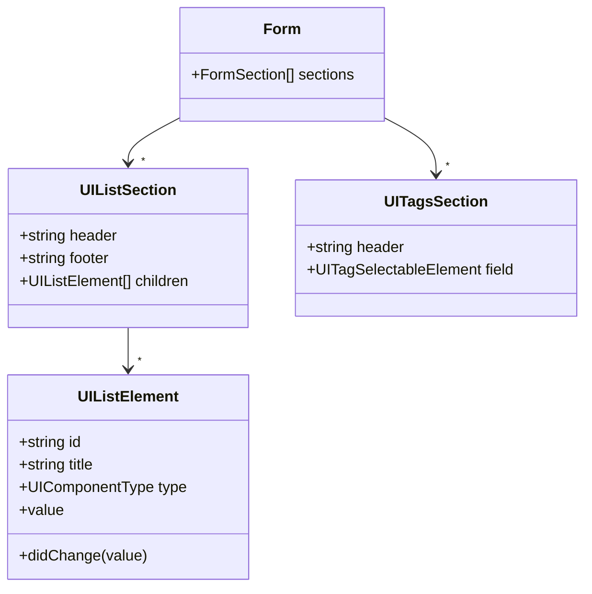
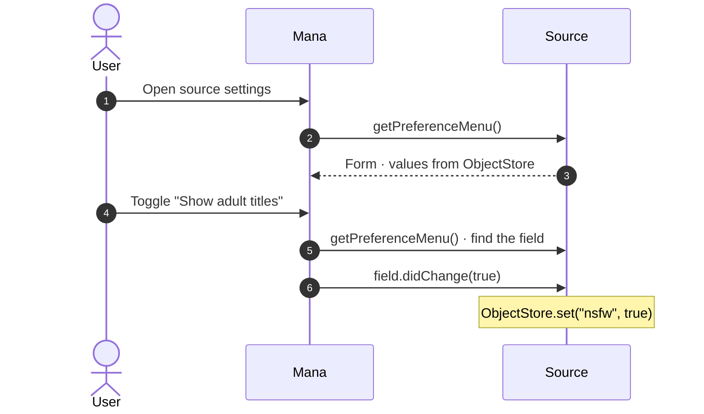

# Forms, preferences and setup

Types: [Form](DataModel.md#form)

A `Form` describes a native settings screen. Sources use it for their settings (`getPreferenceMenu`) and first-run setup (`getSetupMenu`); trackers use it for the entry editor (`getEntryForm`, see [Trackers](Trackers.md#entry-form)).



## Elements

Every element has an `id` and a `title`. Interactive elements also take `value` (the current value to show), `optional: true` (the user may clear it) and `didChange(value)`.

```ts
import {
  UIButton,
  UIDatePicker,
  UIExcludableMultiPicker,
  UIExcludableMultiPickerSheet,
  UIGroup,
  UIListSection,
  UIMenuPicker,
  UIMultiPicker,
  UIMultiPickerSheet,
  UIPicker,
  UIPickerSheet,
  UIStepper,
  UITagsSection,
  UITextField,
  UIToggle,
} from "@mana-app/types";

UIToggle({ id: "nsfw", title: "Show adult titles", value: false, didChange: (v) => save("nsfw", v) });

UITextField({
  id: "server",
  title: "Server URL",
  placeholder: "https://my.server",
  keyboard: "alphanumeric",       // "alphanumeric" | "numeric" | "email"
  secure: false,                  // true masks the text
  multiline: false,
  value: current.server,
  didChange: (v) => save("server", v),
});

UIPicker({ id: "quality", title: "Image quality", options: QUALITIES, value: "high", didChange: (v) => save("quality", v) });
UIMenuPicker({ id: "theme", title: "Theme", options: THEMES, value: "auto", didChange: (v) => save("theme", v) });
UIPickerSheet({ id: "region", title: "Region", options: REGIONS, value: "us", didChange: (v) => save("region", v) });

UIMultiPicker({
  id: "languages",
  title: "Languages",
  options: LANGUAGES,
  minSelectionCount: 1,
  maxSelectionCount: 5,
  value: ["en"],
  didChange: (v) => save("languages", v),          // string[]
});
UIMultiPickerSheet({ id: "groups", title: "Preferred groups", options: GROUPS, value: [], didChange: (v) => save("groups", v) });

UIExcludableMultiPicker({
  id: "blockedTags",
  title: "Tag filter",
  options: TAGS,
  value: { included: [], excluded: ["gore"] },
  didChange: (v) => save("blockedTags", v),        // { included: string[], excluded: string[] }
});
UIExcludableMultiPickerSheet({ id: "genres", title: "Genres", options: TAGS, value: { included: [], excluded: [] } });

UIStepper({
  id: "pages",
  title: "Preload pages",
  lowerBound: 0,
  upperBound: 20,
  step: 1,                        // 10 | 1 | 0.1
  allowDecimal: undefined,
  value: 3,
  didChange: (v) => save("pages", v),
});

UIDatePicker({ id: "since", title: "Only show updates since", optional: true, value: null, didChange: (v) => save("since", v) });

UIButton({
  id: "clearCache",
  title: "Clear cache",
  systemImage: "trash",           // SF Symbol name
  isDestructive: true,
  action: async () => { await ObjectStore.remove("cache"); },
});
```

Sections:

```ts
UIListSection({
  header: "Reading",
  footer: "Changes apply to new chapters.",
  children: [
    UIToggle({ /* … */ }),
    UIGroup({ id: "advanced", title: "Advanced", children: [UIStepper({ /* … */ })] }), // no nested groups
  ],
});

UITagsSection({
  header: "Hidden genres",
  field: UIMultiPicker({ id: "hidden", title: "Hidden genres", options: TAGS, value: [] }),
});
```

| Builder | Value type |
|---|---|
| `UIToggle` | `boolean` |
| `UITextField` | `string` |
| `UIPicker`, `UIMenuPicker`, `UIPickerSheet` | `string` (option ID) |
| `UIMultiPicker`, `UIMultiPickerSheet` | `string[]` |
| `UIExcludableMultiPicker`, `UIExcludableMultiPickerSheet` | `{ included: string[], excluded: string[] }` |
| `UIStepper` | `number` |
| `UIDatePicker` | `Date` in `value`, ISO 8601 string in `didChange` |
| `UIButton` | none; runs `action()` |

## Preferences

`getPreferenceMenu()` builds the settings screen. Mana does not store the values: save them in `didChange` and read them back when building the menu.



```ts
import { UIListSection, UIPicker, UIToggle, type Form, type SourcePreferenceProvider } from "@mana-app/types";

const DEFAULTS = { nsfw: false, language: "en" };

class Preferences {
  async get<K extends keyof typeof DEFAULTS>(key: K): Promise<(typeof DEFAULTS)[K]> {
    return ((await ObjectStore.get(key)) ?? DEFAULTS[key]) as (typeof DEFAULTS)[K];
  }
  set<K extends keyof typeof DEFAULTS>(key: K, value: (typeof DEFAULTS)[K]) {
    return ObjectStore.set(key, value);
  }
}

export class Target implements SourcePreferenceProvider /* , … */ {
  private readonly prefs = new Preferences();

  async getPreferenceMenu(): Promise<Form> {
    return {
      sections: [
        UIListSection({
          header: "Content",
          children: [
            UIToggle({
              id: "nsfw",
              title: "Show adult titles",
              value: await this.prefs.get("nsfw"),
              didChange: (value) => this.prefs.set("nsfw", value),
            }),
            UIPicker({
              id: "language",
              title: "Language",
              options: [{ id: "en", title: "English" }, { id: "fr", title: "French" }],
              value: await this.prefs.get("language"),
              didChange: (value) => this.prefs.set("language", value),
            }),
          ],
        }),
      ],
    };
  }

  async search(request: SearchRequest) {
    const nsfw = await this.prefs.get("nsfw");
    // …
  }
}
```

Mana rebuilds the menu to find the changed field, so keep `getPreferenceMenu` quick and field IDs stable. Errors thrown from `didChange` are logged, not shown.

## First-run setup

> **Not used by Mana yet.** The methods below are part of the API, but the app does not show setup forms today.

All three methods are required. Typical use: a self-hosted server source that needs a URL and API key. `validateSetupForm` receives `{ [fieldId]: value }`; throw to reject.

```ts
async getSetupMenu(): Promise<Form> {
  return {
    sections: [
      UIListSection({
        header: "Server",
        children: [
          UITextField({ id: "url", title: "Server URL", placeholder: "https://komga.local" }),
          UITextField({ id: "apiKey", title: "API key", secure: true }),
        ],
      }),
    ],
  };
}

async validateSetupForm(values: { url?: string; apiKey?: string }): Promise<void> {
  if (!values.url?.startsWith("http")) throw new Error("Enter a server URL starting with http.");
  const response = await this.http.get(`${values.url}/api/v1/me`, { headers: { "X-API-Key": values.apiKey ?? "" } });
  if (!response.ok) throw new Error("The server rejected that API key.");
  await ObjectStore.set("url", values.url);
  await SecureStore.set("apiKey", values.apiKey);
}

async isSourceSetup(): Promise<BooleanState> {
  return { state: (await ObjectStore.get("url")) != null };
}
```
