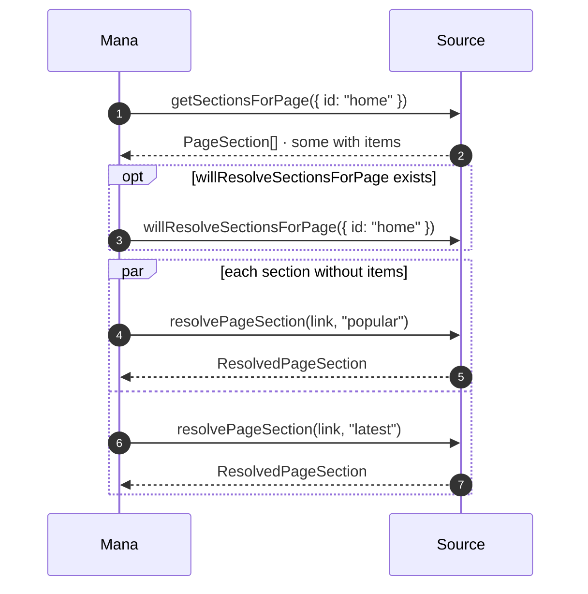
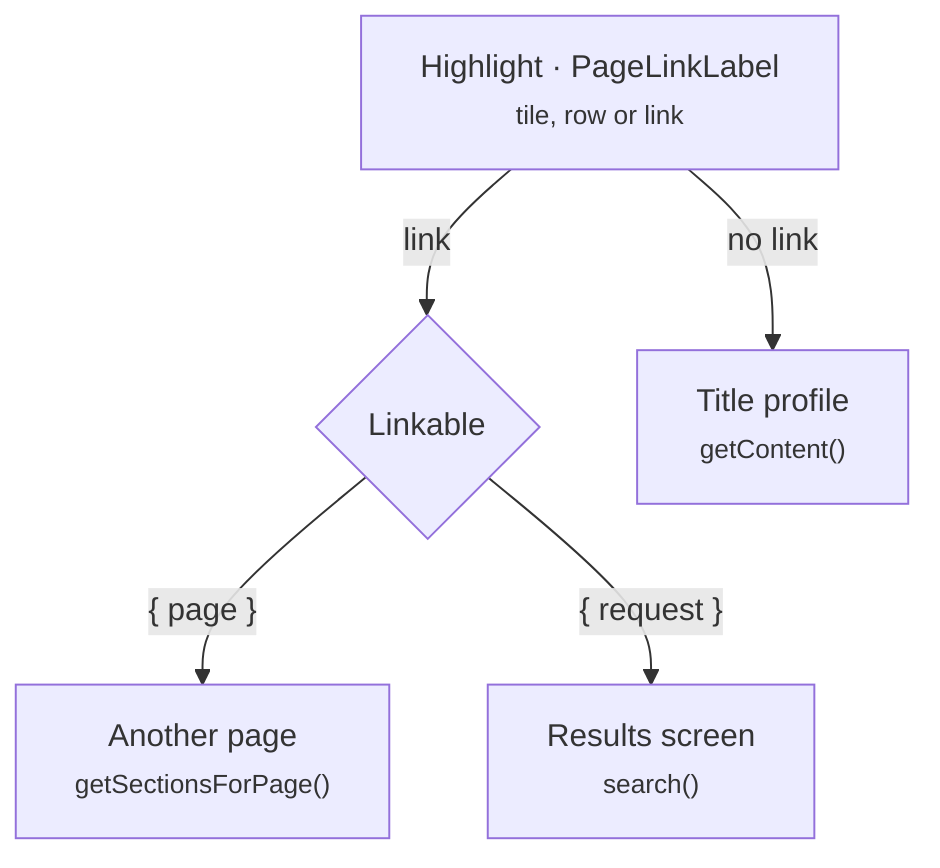

# Pages and links

Types: [PageSection](DataModel.md#pagesection), [Linkable](DataModel.md#linkable), [PageLinkLabel](DataModel.md#pagelinklabel), [Highlight](DataModel.md#highlight)

A source can build its own pages, such as a home screen with "Popular" and "Latest" rows, instead of a plain search grid. Every page is identified by a `PageLink`; the home page is `{ id: "home" }`.





## `getSectionsForPage(link)` and `resolvePageSection(link, sectionId)`

Both are required for custom pages. Return section outlines first; Mana resolves them in parallel so the page fills in row by row.

```ts
import {
  SectionStyle,
  type PageLink,
  type PageSection,
  type ResolvedPageSection,
} from "@mana-app/types";

async getSectionsForPage(link: PageLink): Promise<PageSection[]> {
  switch (link.id) {
    case "home":
      return [
        { id: "featured", title: "Featured", style: SectionStyle.SimpleHeroPaged },
        { id: "popular", title: "Popular", style: SectionStyle.SimpleSingleRow },
        {
          id: "latest",
          title: "Latest Updates",
          subtitle: "Updated in the last 24 hours",
          style: SectionStyle.DetailedVerticalListGrouped,
        },
        {
          // Sections with items are already resolved.
          id: "genres",
          title: "Genres",
          style: SectionStyle.Grid,
          items: GENRES.map((g) => ({
            id: g.id,
            title: g.title,
            cover: g.image,
            link: { request: { page: 1, filters: { genres: [g.id] } } },
          })),
        },
      ];
    case "rankings":
      return [{ id: "weekly", title: "This week", style: SectionStyle.DetailedVerticalList }];
    default:
      throw new Error(`Unknown page ${link.id}`);
  }
}

async resolvePageSection(link: PageLink, sectionId: string): Promise<ResolvedPageSection> {
  switch (sectionId) {
    case "popular": {
      const { results } = await this.search({ page: 1, sort: { id: "popular" } });
      return {
        items: results,
        viewMoreLink: { request: { page: 1, sort: { id: "popular" } } },
      };
    }
    case "latest": {
      const { results } = await this.search({ page: 1, sort: { id: "updated" } });
      return { items: results, updatedSubtitle: `${results.length} titles` };
    }
    case "featured":
      return { items: await this.featured() };
    case "weekly":
      return { items: await this.ranking("week"), updatedTitle: "Top 50 this week" };
    default:
      throw new Error(`Unknown section ${sectionId}`);
  }
}
```

### `willResolveSectionsForPage(link)` (optional)

Runs once before the sections resolve. Use it to load one shared response that several sections read from.

```ts
private homeCache?: Promise<any>;

async willResolveSectionsForPage(link: PageLink): Promise<void> {
  if (link.id === "home") this.homeCache = this.http.get("/api/home").then((r) => r.requireOk().json());
}

async resolvePageSection(link: PageLink, sectionId: string): Promise<ResolvedPageSection> {
  const home = await (this.homeCache ??= this.http.get("/api/home").then((r) => r.requireOk().json()));
  return { items: home[sectionId].map(toHighlight) };
}
```

### Section styles

| Style | Looks like |
|---|---|
| `SimpleSingleRow`, `SimpleDoubleRow`, `SimpleTripleRow` | Horizontal rows of covers (1–3 rows) |
| `SimpleHero`, `SimpleHeroPaged` | Large banner, single or paged |
| `DetailedSingleRowPaged`, `DetailedDoubleRowPaged`, `DetailedTripleRowPaged` | Paged rows with title, subtitle and info |
| `DetailedVerticalList`, `DetailedVerticalListGrouped` | Vertical list, optionally grouped |
| `Grid` | Grid of tiles |

## Linkable

Any `Highlight.link`, `viewMoreLink` or `PageLinkLabel.link` is one of:

```ts
// Open another custom page.
{ page: { id: "rankings" } }

// Open search results with a prefilled request.
{ request: { page: 1, query: "isekai", sort: { id: "updated", ascending: false }, filters: { status: "ongoing" } } }
```

A `Highlight` without `link` opens the title profile (`getContent(highlight.id)`). Set `noninteractive: true` for tiles that should not open anything.

## `getLibraryPageLinks()`

Links shown in the library, for example the user's lists on the site.

```ts
import type { PageLinkLabel } from "@mana-app/types";

async getLibraryPageLinks(): Promise<PageLinkLabel[]> {
  const lists = await this.userLists();
  return [
    { title: "Reading", subtitle: `${lists.reading} titles`, link: { request: { page: 1, listId: "reading" } } },
    { title: "Plan to read", link: { request: { page: 1, listId: "planned" } } },
    { title: "History", badge: { text: "NEW" }, link: { page: { id: "history" } } },
  ];
}
```

`listId` arrives in `search(request)`, so one method serves every list.
