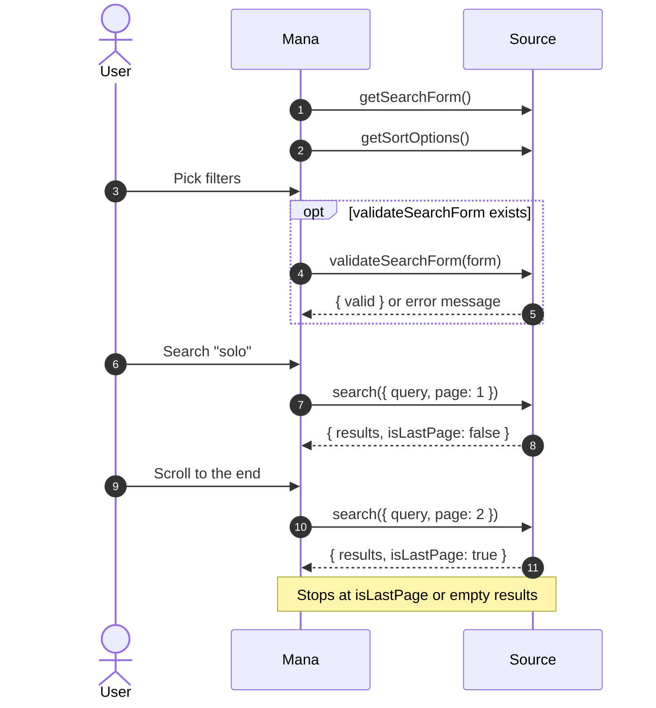

# Search

Types: [SearchRequest](DataModel.md#searchrequest), [PagedSearchResult](DataModel.md#pagedsearchresult), [Highlight](DataModel.md#highlight), [SearchForm](DataModel.md#searchform)



## `search(request)`

```ts
import type { Highlight, PagedSearchResult, SearchRequest } from "@mana-app/types";

async search(request: SearchRequest): Promise<PagedSearchResult> {
  const { query, page, sort, filters = {} } = request;

  const params: Record<string, string | number | boolean | string[]> = { page };
  if (query) params.q = query;
  if (sort) {
    params.order = sort.id;
    params.dir = sort.ascending ? "asc" : "desc";
  }
  if (filters.status) params.status = filters.status;                 // SELECT → "ongoing"
  if (filters.genres) params["genre[]"] = filters.genres;             // MULTISELECT → ["action", "drama"]
  if (filters.tags) {                                                 // EXCLUDABLE_MULTISELECT
    params["include[]"] = filters.tags.included;
    params["exclude[]"] = filters.tags.excluded;
  }
  if (filters.completedOnly) params.completed = true;                 // TOGGLE → true
  if (filters.minChapters) params.min = filters.minChapters;          // STEPPER → 10
  if (filters.author) params.author = filters.author;                 // TEXT → "Jane"
  if (filters.since) params.since = filters.since;                    // DATEPICKER → ISO 8601 string

  const json = await (await this.http.get("/api/search", { params })).requireOk().json<any>();

  const results: Highlight[] = json.items.map((item: any) => ({
    id: String(item.id),
    title: item.title,
    cover: item.cover,
    subtitle: item.latest_chapter ? `Chapter ${item.latest_chapter}` : undefined,
    info: [{ key: "Rating", value: String(item.score) }],
    badge: item.is_new ? { text: "NEW" } : undefined,
    webUrl: `https://example.org/series/${item.id}`,
  }));

  return { results, isLastPage: !json.has_next, totalResultCount: json.total };
}
```

- `page` starts at 1.
- `filters` is keyed by field `id` and only contains fields the user set.
- Option fields send option **IDs**: a string for `SELECT`, a string array for `MULTISELECT`, and `{ included: string[], excluded: string[] }` for `EXCLUDABLE_MULTISELECT`.
- `listId` is set when the user opened a list from a [link](Pages.md#linkable) whose request carries one.
- `request.context.allowedContentRatings` lists the ratings the user allows.

The same method backs browsing: a tag tap or a "view more" link calls `search` with prefilled `filters` or `sort`.

## `getSortOptions()`

```ts
import type { SortOption } from "@mana-app/types";

async getSortOptions(): Promise<SortOption[]> {
  return [
    { id: "popular", title: "Popularity", isDefault: true },
    { id: "updated", title: "Last Updated", isOrderable: true, defaultAscending: false },
    { id: "title", title: "Title", isOrderable: true },
  ];
}
```

`isOrderable` lets the user flip direction; the choice arrives as `sort.ascending`.

## `getSearchForm()`

Build the filter screen from sections. Each field's `id` becomes its key in `request.filters`.

```ts
import {
  SearchDatePicker,
  SearchExcludableMultiPickerSheet,
  SearchGroup,
  SearchListSection,
  SearchMenuPicker,
  SearchMultiPicker,
  SearchPicker,
  SearchSortSection,
  SearchStepper,
  SearchTagsSection,
  SearchTextField,
  SearchToggle,
  SearchExcludableMultiPicker,
  type SearchForm,
} from "@mana-app/types";

async getSearchForm(): Promise<SearchForm> {
  const genres = await this.genres(); // [{ id: "action", title: "Action" }, …]

  return {
    sections: [
      SearchSortSection({ header: "Sort" }),

      SearchListSection({
        header: "Filters",
        footer: "Filters combine with AND.",
        children: [
          SearchPicker({
            id: "status",
            title: "Status",
            options: [
              { id: "ongoing", title: "Ongoing" },
              { id: "completed", title: "Completed" },
            ],
          }),
          SearchMenuPicker({ id: "type", title: "Type", options: [{ id: "manga", title: "Manga" }, { id: "manhwa", title: "Manhwa" }] }),
          SearchMultiPicker({ id: "genres", title: "Genres", options: genres }),
          SearchToggle({ id: "completedOnly", title: "Completed only", subtitle: "Hide ongoing series" }),
          SearchTextField({ id: "author", title: "Author", placeholder: "Name" }),
          SearchStepper({ id: "minChapters", title: "Minimum chapters", lowerBound: 0, upperBound: 500, step: 10 }),
          SearchDatePicker({ id: "since", title: "Updated since" }),

          // A collapsible group of fields.
          SearchGroup({
            id: "advanced",
            title: "Advanced",
            children: [
              SearchExcludableMultiPickerSheet({ id: "themes", title: "Themes", options: genres }),
            ],
          }),
        ],
      }),

      // A tag cloud: tap to include, tap again to exclude.
      SearchTagsSection({
        header: "Tags",
        field: SearchExcludableMultiPicker({ id: "tags", title: "Tags", options: genres }),
      }),
    ],
  };
}
```

| Builder | Shows | Value in `filters` |
|---|---|---|
| `SearchPicker`, `SearchMenuPicker`, `SearchPickerSheet` | Single choice (list, menu, sheet) | `"optionId"` |
| `SearchMultiPicker`, `SearchMultiPickerSheet` | Multiple choice | `["id1", "id2"]` |
| `SearchExcludableMultiPicker`, `SearchExcludableMultiPickerSheet` | Include/exclude | `{ included: [...], excluded: [...] }` |
| `SearchToggle` | Switch | `true` / `false` |
| `SearchTextField` | Text field | `"text"` |
| `SearchStepper` | Number stepper (`lowerBound`, `upperBound`, `step`, `allowDecimal`) | `12` |
| `SearchDatePicker` | Date | `"2026-01-31T00:00:00Z"` |
| `SearchGroup` | Collapsible group inside a list section (no nesting) | — |
| `SearchListSection`, `SearchTagsSection`, `SearchSortSection` | Sections | — |

## `validateSearchForm(form)`

Check combinations before Mana applies them. `fieldErrors` marks individual fields.

```ts
import type { SearchFormSubmission, SearchFormValidationResult } from "@mana-app/types";

async validateSearchForm(form: SearchFormSubmission): Promise<SearchFormValidationResult> {
  const tags = form.filters?.tags as { included: string[]; excluded: string[] } | undefined;

  if (tags && tags.included.length > 5) {
    return {
      valid: false,
      message: "Example allows at most 5 included tags.",
      fieldErrors: { tags: "Pick 5 or fewer" },
    };
  }

  if (form.sort?.id === "relevance" && !form.filters?.author) {
    return { valid: false, message: "Relevance sorting needs an author." };
  }

  return { valid: true };
}
```
