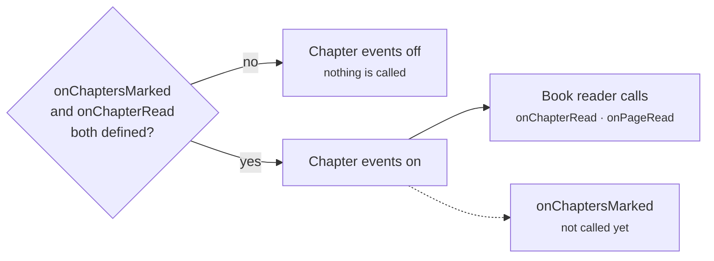

# API status

Which parts of the source API Mana uses today. Everything not listed here is used. Methods marked "not used yet" are part of the API and safe to implement, but Mana does not call them, so they have no effect for now.

## Not used yet

| Area | Methods / properties | Notes |
|---|---|---|
| [First-run setup](Forms.md#first-run-setup) | `getSetupMenu`, `validateSetupForm`, `isSourceSetup` | Mana shows no setup forms. |
| [Password sign-in](Authentication.md#username-or-email-and-password) | `handleBasicAuth`, `BasicAuthenticationUIIdentifier` | Only OAuth is offered, for sources and trackers. |
| [Web sign-in](Authentication.md#web-login) | `getWebAuthRequestURL`, `didReceiveSessionCookieFromWebAuthResponse` | Only OAuth is offered. |
| [Marking chapters](Events.md#reading-events) | `onChaptersMarked` | Never called, but still required for reading events (see below). |
| [Library events](Events.md#library-events) | `onContentsAddedToLibrary`, `onContentsRemovedFromLibrary` | Adding or removing titles does not notify the source. |
| [Library links](Pages.md#getlibrarypagelinks) | `getLibraryPageLinks` | The links are not shown anywhere. |
| [Library sync](Events.md#library-sync-and-grouped-updates) | `syncUserLibrary`, `getGroupedUpdates` | Library updates check titles one by one. |
| [Extra profile sections](Content.md#extra-profile-sections) | `getAdditionalInfoSectionItems` | Sections show only the items in `Content.additionalInfo`; `hasMore` has no effect. |

## Partly used

| Method | What Mana uses | What it ignores |
|---|---|---|
| [`onChapterRead`, `onPageRead`](Events.md#reading-events) | Calls from the book reader (EPUB, PDF, text) | The image reader does not send reading events. |
| [`getProgressState`](Events.md#progress-sync) | `readChapterIds`, during library updates | `currentReadingState`, `markAllBelowAsRead` |

## Things to watch for

Reading events are only switched on when the source defines both `onChaptersMarked` and `onChapterRead`, even though Mana never calls `onChaptersMarked` today.



```ts
import { Body } from "@mana-app/types";

// Define it, even as a no-op, so the reading events reach your source.
async onChaptersMarked(contentId: string, chapterIds: string[], completed: boolean): Promise<void> {}

async onChapterRead(contentId: string, chapterId: string): Promise<void> {
  await this.http.post("/api/history", Body.json({ series: contentId, chapter: chapterId }));
}
```

One name differs from `@mana-app/types`:

| Use this | Not this | Why |
|---|---|---|
| `BasicAuthenticationUIIdentifier` | `BasicAuthUIIdentifier` | The build reads this name to label the sign-in field. |
