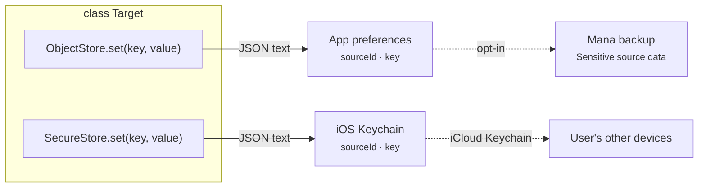
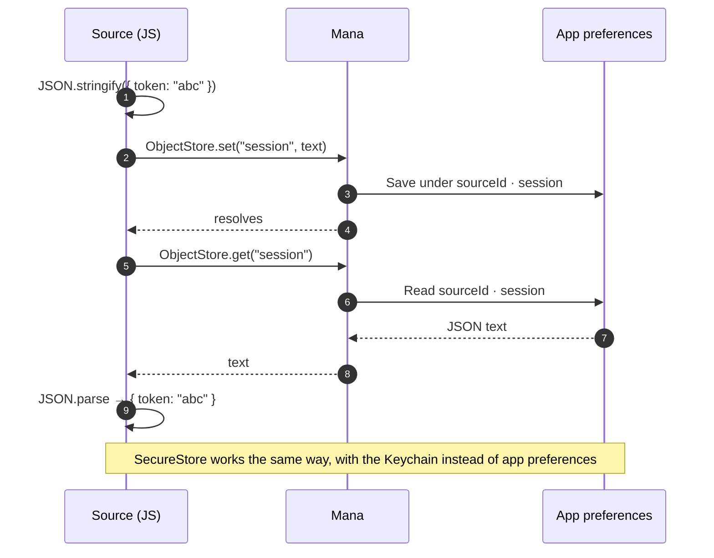
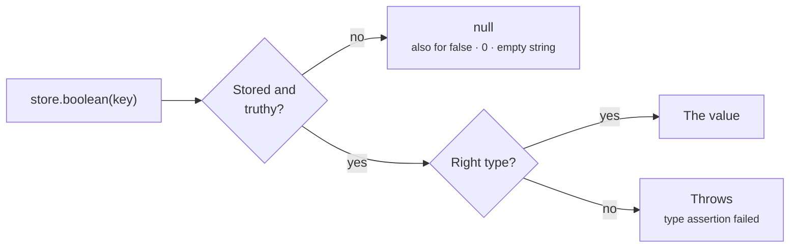
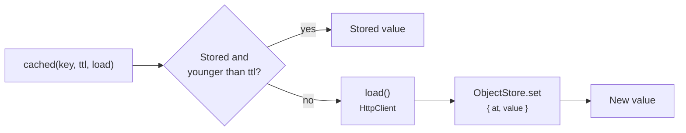

# Storage

Two global key/value stores keep data between launches. Both are scoped to your source (and to each instance when `allowsMultipleInstances` is on), and both store any JSON value.

| Store | Kept in | Synced | In Mana backups | Use for |
|---|---|---|---|---|
| `ObjectStore` | Mana's app preferences on the device | No | Only when the user includes "Sensitive source data" | Settings, caches, IDs, timestamps |
| `SecureStore` | iOS Keychain | Yes, through iCloud Keychain | No | Tokens, passwords, API keys |



Values stay when the source is updated or uninstalled, so a reinstalled source finds its old settings and tokens. Clear what you no longer need with `remove`.

## API

```ts
// Write any JSON value.
await ObjectStore.set("lastSync", Date.now());
await ObjectStore.set("session", { token: "abc", expires: 1767225600 });
await SecureStore.set("password", "hunter2");

// Read. Returns null when missing.
const session = (await ObjectStore.get("session")) as { token: string; expires: number } | null;

// Remove.
await ObjectStore.remove("session");

// Typed reads: throw if the stored value has another type.
const token = await SecureStore.string("token");             // string | null
const nsfw = await ObjectStore.boolean("nsfw");              // boolean | null
const page = await ObjectStore.number("page");               // number | null
const languages = await ObjectStore.stringArray("languages"); // string[] | null
```

Every call is a round trip to Mana: the value is turned into JSON text in JavaScript, stored as text, and parsed again when read.



The typed reads check the parsed value. They return `null` for falsy values too (`false`, `0`, `""`):



For settings that can be `false` or `0`, use `get` with a default:

```ts
const nsfw = ((await ObjectStore.get("nsfw")) as boolean | null) ?? true;
```

## Patterns

### Typed settings

```ts
const DEFAULTS = { nsfw: false, quality: "high", languages: ["en"] };
type Settings = typeof DEFAULTS;

async function setting<K extends keyof Settings>(key: K): Promise<Settings[K]> {
  return ((await ObjectStore.get(key)) as Settings[K] | null) ?? DEFAULTS[key];
}

const quality = await setting("quality");
```

### Cache with expiry



```ts
async function cached<T>(key: string, ttlMs: number, load: () => Promise<T>): Promise<T> {
  const entry = (await ObjectStore.get(key)) as { at: number; value: T } | null;
  if (entry && Date.now() - entry.at < ttlMs) return entry.value;

  const value = await load();
  await ObjectStore.set(key, { at: Date.now(), value });
  return value;
}

const genres = await cached("genres", 24 * 60 * 60 * 1000, () => this.fetchGenres());
```

### Token storage

```ts
async function saveTokens(t: { access: string; refresh: string; expiresIn: number }) {
  await SecureStore.set("tokens", { ...t, expiresAt: Date.now() + t.expiresIn * 1000 });
}

async function accessToken(): Promise<string | null> {
  const t = (await SecureStore.get("tokens")) as { access: string; expiresAt: number } | null;
  return t && t.expiresAt > Date.now() ? t.access : null;
}
```

Keep the stored shape small: each `get` reads and parses the whole value.
