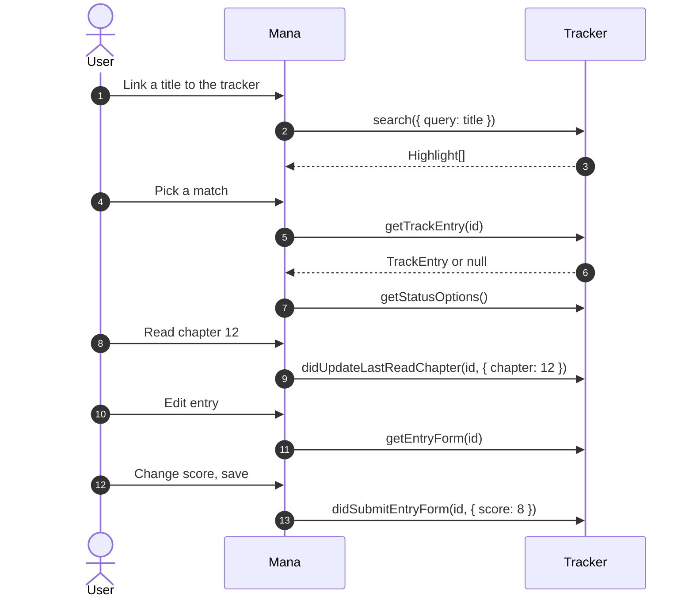

# Trackers

Types: [TrackEntry](DataModel.md#tracker), [Form](DataModel.md#form)

A tracker syncs reading progress to a service such as AniList, MyAnimeList or Kitsu. It is a source without chapters: it searches and shows titles, and keeps the user's list entry up to date.

The build treats a class as a tracker when it has all of `getContent`, `search`, `didUpdateLastReadChapter`, `didUpdateStatus`, `getEntryForm` and `didSubmitEntryForm`. Trackers sign in with [OAuth](Authentication.md#oauth).



## Linking titles

Sources can pre-link titles through `Content.trackerInfo`. The keys must match the tracker's link keys (its `info.id` unless `trackerConfig.linkKeys` says otherwise):

```ts
// In a content source
return { title, cover, trackerInfo: { anilist: "21", mal: "13" } };

// In the AniList tracker
readonly trackerConfig = { linkKeys: ["anilist", "al"], owningLinks: ["anilist.co"] };
```

## Methods

### `getTrackEntry(id)`

```ts
import type { TrackEntry } from "@mana-app/types";

async getTrackEntry(id: string): Promise<TrackEntry | null> {
  const data = await this.gql(`query ($id: Int) { Media(id: $id) { chapters mediaListEntry { status progress progressVolumes } } }`, { id: Number(id) });
  const entry = data.Media.mediaListEntry;
  if (!entry) return null;   // not on the user's list

  return {
    status: entry.status,                          // one of the status option IDs
    progress: {
      lastReadChapter: entry.progress,
      lastReadVolume: entry.progressVolumes ?? undefined,
      maxAvailableChapter: data.Media.chapters ?? undefined,
    },
  };
}
```

### `getStatusOptions()`

```ts
async getStatusOptions(): Promise<TrackerStatusOption[]> {
  return [
    { id: "CURRENT", title: "Reading", isDefault: true },
    { id: "PLANNING", title: "Plan to read" },
    { id: "COMPLETED", title: "Completed" },
    { id: "PAUSED", title: "Paused" },
    { id: "DROPPED", title: "Dropped" },
    { id: "REPEATING", title: "Rereading" },
  ];
}
```

### `didUpdateStatus(id, status)`

Create the entry if it doesn't exist yet.

```ts
async didUpdateStatus(id: string, status: string): Promise<void> {
  await this.gql(`mutation ($id: Int, $status: MediaListStatus) { SaveMediaListEntry(mediaId: $id, status: $status) { id } }`, { id: Number(id), status });
}
```

### `didUpdateLastReadChapter(id, progress)`

Called when the user reads past the tracked chapter.

```ts
async didUpdateLastReadChapter(id: string, progress: TrackProgressUpdate): Promise<void> {
  await this.gql(
    `mutation ($id: Int, $p: Int, $v: Int) { SaveMediaListEntry(mediaId: $id, progress: $p, progressVolumes: $v) { id } }`,
    { id: Number(id), p: progress.chapter, v: progress.volume },
  );
}
```

### `removeTracking(id)`

```ts
async removeTracking(id: string): Promise<void> {
  const entryId = await this.entryId(id);
  if (entryId) await this.gql(`mutation ($e: Int) { DeleteMediaListEntry(id: $e) { deleted } }`, { e: entryId });
}
```

### Entry form

`getEntryForm` builds the editor with [form elements](Forms.md#elements). `didSubmitEntryForm` receives only the fields the user changed; cleared fields are `null` and dates are ISO 8601 strings.

```ts
import { UIDatePicker, UIListSection, UIPicker, UIStepper, UITextField, UIToggle, type Form } from "@mana-app/types";

async getEntryForm(id: string): Promise<Form> {
  const e = await this.fullEntry(id);
  return {
    sections: [
      UIListSection({
        header: "Progress",
        children: [
          UIPicker({ id: "status", title: "Status", options: await this.getStatusOptions(), value: e.status }),
          UIStepper({ id: "progress", title: "Chapter", lowerBound: 0, upperBound: e.chapters ?? undefined, value: e.progress }),
          UIStepper({ id: "score", title: "Score", lowerBound: 0, upperBound: 10, step: 0.1, allowDecimal: true, value: e.score }),
        ],
      }),
      UIListSection({
        header: "Dates",
        children: [
          UIDatePicker({ id: "startedAt", title: "Started", optional: true, value: e.startedAt }),
          UIDatePicker({ id: "completedAt", title: "Finished", optional: true, value: e.completedAt }),
        ],
      }),
      UIListSection({
        header: "Other",
        children: [
          UIToggle({ id: "private", title: "Private", value: e.private }),
          UITextField({ id: "notes", title: "Notes", multiline: true, optional: true, value: e.notes }),
        ],
      }),
    ],
  };
}

async didSubmitEntryForm(id: string, form: Record<string, unknown>): Promise<void> {
  // e.g. { score: 8.5, completedAt: "2026-10-20T00:00:00Z", notes: null }
  const variables: Record<string, unknown> = { id: Number(id) };
  if ("status" in form) variables.status = form.status;
  if ("progress" in form) variables.progress = form.progress;
  if ("score" in form) variables.score = form.score ?? 0;
  if ("notes" in form) variables.notes = form.notes ?? "";
  if ("completedAt" in form) variables.completedAt = toFuzzyDate(form.completedAt as string | null);
  await this.gql(SAVE_ENTRY_MUTATION, variables);
}
```

## Search results with entries

On tracker pages, a `Highlight` can carry the user's entry so the tile shows their status:

```ts
results: media.map((m) => ({
  id: String(m.id),
  title: m.title.romaji,
  cover: m.coverImage.large,
  entry: m.mediaListEntry && {
    status: m.mediaListEntry.status,
    progress: { lastReadChapter: m.mediaListEntry.progress, maxAvailableChapter: m.chapters },
  },
})),
```
