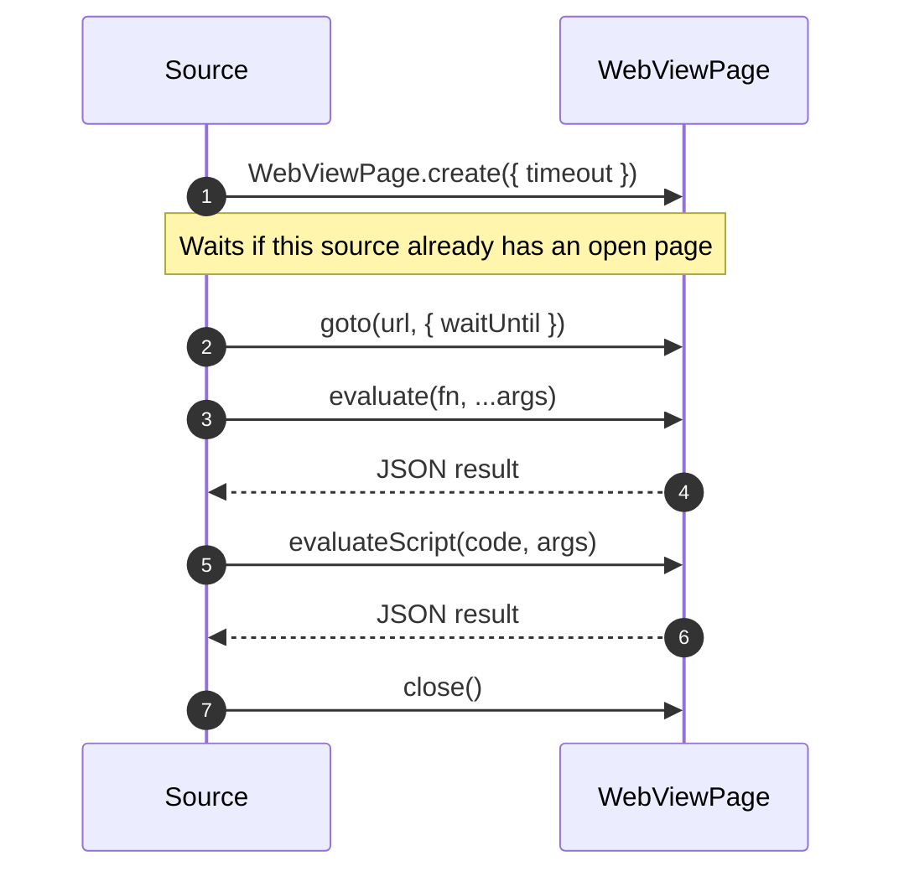

# WebView pages

Types: [WebViewPage](DataModel.md#webviewpage)

`WebViewPage` is a hidden browser page. Use it when a site only works with its own JavaScript running: tokens computed in the page, content rendered client-side, or anti-bot scripts. Prefer `HttpClient` whenever an API or plain HTML works, since a page is much slower.



## Example

```ts
async getChapterData(contentId: string, chapterId: string): Promise<ChapterData> {
  const page = await WebViewPage.create({ timeout: 30 });
  try {
    await page.goto(`https://example.org/read/${chapterId}`, { waitUntil: "load" });

    // Runs inside the page. Pass values as arguments; it cannot see source variables.
    const urls = await page.evaluate(
      (selector: string) => [...document.querySelectorAll<HTMLImageElement>(selector)].map((img) => img.src),
      ".reader img",
    );

    return { pages: urls.map((url) => ({ url })) };
  } finally {
    await page.close();
  }
}
```

## API

### `WebViewPage.create(options?)`

| Option | Default | Meaning |
|---|---|---|
| `timeout` | 30 | Seconds before any single action fails |
| `idleTimeout` | 30 | Seconds of inactivity before the page closes itself |

A source has one page at a time. A second `create` waits until the first page closes, so always close pages promptly.

### `page.goto(url, options?)`

```ts
await page.goto("https://example.org/series/1");                                  // waits for "load"
await page.goto("https://example.org/series/1", { waitUntil: "domcontentloaded" }); // faster
await page.goto("https://example.org/slow", { timeout: 60 });
```

Only `http` and `https` URLs are allowed.

### `page.evaluate(fn, ...args)`

Serializes `fn`, runs it in the page and returns its JSON result. `fn` can be `async`.

```ts
const token = await page.evaluate(() => (window as any).__APP_STATE__.token);

const data = await page.evaluate(async (id: string) => {
  const response = await fetch(`/api/chapter/${id}`);      // the page's own fetch, with its cookies
  return response.json();
}, chapterId);

// Wait for client-side rendering.
const titles = await page.evaluate(async () => {
  for (let i = 0; i < 50 && !document.querySelector(".item"); i++) {
    await new Promise((r) => setTimeout(r, 100));
  }
  return [...document.querySelectorAll(".item .title")].map((el) => el.textContent?.trim());
});
```

### `page.evaluateScript(code, args?)`

Same, but takes source code as a string. Arguments arrive as `args`; `await` and `return` work.

```ts
const sum = await page.evaluateScript("return args[0] + args[1];", [40, 2]);           // 42
const html = await page.evaluateScript("return document.documentElement.outerHTML;");
const value = await page.evaluateScript(`
  await new Promise((r) => setTimeout(r, 500));
  return localStorage.getItem(args[0]);
`, ["session"]);
```

### `page.close()`

Always call it in `finally`. A page also closes after `idleTimeout`, or when an action times out or is cancelled; using it afterwards throws `WebViewPageClosed`.

## Rules

- Arguments and results must be JSON-compatible: no functions, `Date`s become strings, `undefined` is dropped.
- Run one action at a time on a page. Starting a second `goto` or `evaluate` before the first finishes throws `WebViewPageActionInProgress`.
- Waiting for a page does not block your other methods, but it does block other `create` calls from the same source.
