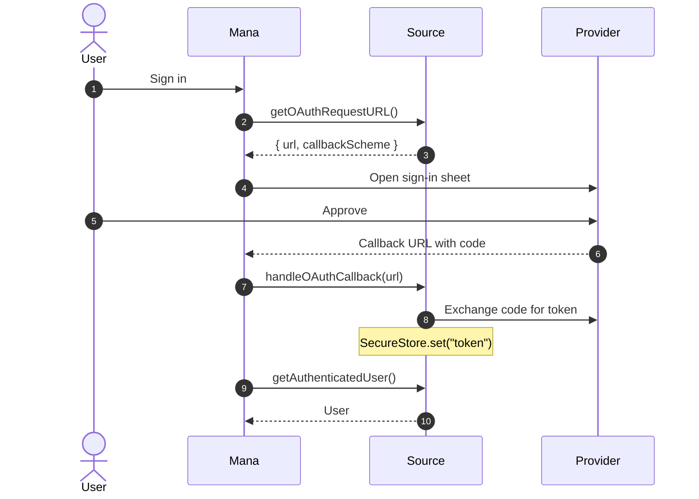

# Authentication

Types: [User](data-model.md#user), [BasicURL / OAuthURL](data-model.md#urls)

Every sign-in style needs both of these:

```ts
import type { User } from "@mana-app/types";

async getAuthenticatedUser(): Promise<User | null> {
  const token = await SecureStore.string("token");
  if (!token) return null;

  const me = await (await this.http.get("/api/me", { headers: { Authorization: `Bearer ${token}` } })).json<any>();
  return {
    handle: me.username,
    displayName: me.name,
    avatar: me.avatar_url,
    bannerImage: me.banner_url,
    info: [`${me.library_count} titles`, `Member since ${me.joined_year}`],
  };
}

async handleUserSignOut(): Promise<void> {
  await SecureStore.remove("token");
}
```

Then implement exactly one style. If a source has several, only the first is offered, in the order password, web, OAuth.

| Style | Methods | Mana today |
|---|---|---|
| OAuth | `getOAuthRequestURL`, `handleOAuthCallback` | ✓ |
| Username/email and password | `handleBasicAuth` | Not used yet |
| Web login | `getWebAuthRequestURL`, `didReceiveSessionCookieFromWebAuthResponse` | Not used yet |

Store tokens in [`SecureStore`](storage.md), and attach them with a [request interceptor](networking.md#interceptors) so every request is signed.

## OAuth



```ts
import { Body, type OAuthURL } from "@mana-app/types";

const CLIENT_ID = "1234";

async getOAuthRequestURL(): Promise<OAuthURL> {
  return {
    url: "https://anilist.co/api/v2/oauth/authorize",
    params: { client_id: CLIENT_ID, response_type: "code", redirect_uri: "mana-example://callback" },
    callbackScheme: "mana-example",                 // scheme only, no "://"
  };
}

async handleOAuthCallback(response: string): Promise<void> {
  // `response` is the full callback URL.
  const code = /[?&]code=([^&]+)/.exec(response)?.[1];
  if (!code) throw new Error("Sign-in was cancelled.");

  const token = await (await this.http.post(
    "https://anilist.co/api/v2/oauth/token",
    Body.json({ grant_type: "authorization_code", client_id: CLIENT_ID, code, redirect_uri: "mana-example://callback" }),
  )).requireOk().json<{ access_token: string }>();

  await SecureStore.set("token", token.access_token);
}
```

For implicit-grant providers the token is in the fragment (`#access_token=…`); parse `response` the same way.

## Username or email and password

> **Not used by Mana yet.**

```ts
import { BasicAuthenticationUIIdentifier, Body } from "@mana-app/types";

export class Target {
  // Label the login field "Email" instead of "Username".
  readonly BasicAuthenticationUIIdentifier = BasicAuthenticationUIIdentifier.EMAIL;

  async handleBasicAuth(identifier: string, password: string): Promise<void> {
    const response = await this.http.post("/api/login", Body.json({ email: identifier, password }), { retry: 0 });
    if (response.status === 401) throw new Error("Wrong email or password.");
    const { token } = await response.requireOk().json<{ token: string }>();
    await SecureStore.set("token", token);
  }
}
```

Name the property `BasicAuthenticationUIIdentifier`; the build reads that name (the types package calls it `BasicAuthUIIdentifier`).

## Web login

> **Not used by Mana yet.**

Mana opens your login page in a browser and reports every cookie it receives. Return `true` once the session cookie arrives. Cookies are shared with `HttpClient`, so later requests are signed in automatically.

```ts
import type { BasicURL, BooleanState } from "@mana-app/types";

async getWebAuthRequestURL(): Promise<BasicURL> {
  return { url: "https://example.org/login", params: { next: "/" } };
}

async didReceiveSessionCookieFromWebAuthResponse(name: string): Promise<BooleanState> {
  return { state: name === "session_id" };
}

async getAuthenticatedUser(): Promise<User | null> {
  const response = await this.http.get("/api/me");
  if (response.status === 401) return null;
  const me = await response.requireOk().json<any>();
  return { handle: me.username, avatar: me.avatar };
}
```

## Content behind sign-in

Set `config.requiresAuthenticationToAccessContent: true` when nothing works signed out. Throw a clear error when a request needs an account:

```ts
if (response.status === 401) throw new Error("Sign in to Example in the source settings to read this.");
```
