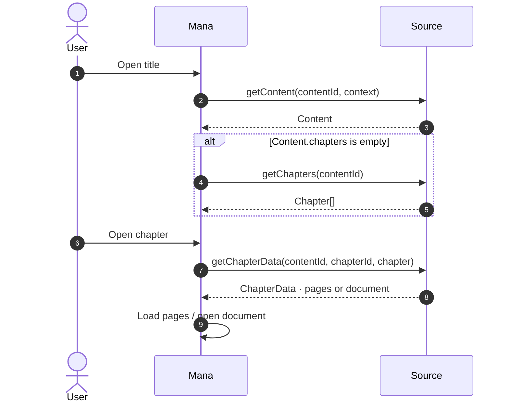
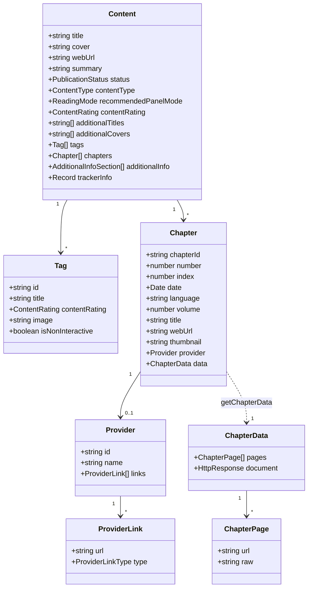

# Content and chapters

Types: [Content](data-model.md#content), [Chapter](data-model.md#chapter), [ChapterData](data-model.md#chapterdata)





## `getContent(contentId, context?)`

Returns the title's profile. Only `title` and `cover` are required.

```ts
import {
  ContentRating,
  ContentType,
  PublicationStatus,
  ReadingMode,
  type Content,
  type SourceContext,
} from "@mana-app/types";

async getContent(contentId: string, context?: SourceContext): Promise<Content> {
  const json = await (await this.http.get(`/api/series/${contentId}`)).requireOk().json<any>();

  return {
    title: json.title,
    cover: json.cover_url,
    webUrl: `https://example.org/series/${contentId}`,
    summary: json.description,
    additionalTitles: json.alt_titles,
    additionalCovers: json.volume_covers,
    status: json.completed ? PublicationStatus.COMPLETED : PublicationStatus.ONGOING,
    contentType: ContentType.MANHWA,
    recommendedPanelMode: ReadingMode.WEBTOON,
    contentRating: json.adult ? ContentRating.EXPLICIT : ContentRating.SAFE,
    tags: json.genres.map((g: any) => ({ id: g.slug, title: g.name })),
    trackerInfo: { anilist: String(json.anilist_id), mal: String(json.mal_id) },
  };
}
```

`context` tells you why Mana is asking:

```ts
import { ContentRating, SourceContextOrigin } from "@mana-app/types";

// Migration: the user is moving a title from another source. Skip slow extras.
if (context?.origin === SourceContextOrigin.MIGRATION) { /* … */ }

// Ratings the user allows. Use it to pick an API filter.
const allowed = context?.allowedContentRatings ?? [ContentRating.SAFE];
const nsfw = allowed.includes(ContentRating.EXPLICIT);
```

`trackerInfo` links the title to [trackers](trackers.md). Keys are tracker link keys (for example `anilist`, `mal`); values are that tracker's IDs.

### Chapters inside `Content`

Many sites show chapters on the title page. Fill `chapters` to save a request; Mana then does not call `getChapters`. A source without a `getChapters` method must always fill it.

```ts
return {
  title: $("h1").text(),
  cover: $(".cover img").attr("src")!,
  chapters: parseChapters($),
};
```

### Extra profile sections

`additionalInfo` adds rows below the summary: staff, characters, related titles, links and tags. Use the builders so each item gets its `type`.

```ts
import { AdditionalInfoType, additionalInfo } from "@mana-app/types";

additionalInfo: [
  additionalInfo.staff.section({
    id: "staff",
    title: "Staff",
    hasMore: false,
    items: [
      additionalInfo.staff.item({ id: "a1", title: "Jane Doe", subtitle: "Story", image: "https://…/jane.jpg" }),
    ],
  }),
  additionalInfo.characters.section({
    id: "characters",
    title: "Characters",
    hasMore: false,
    items: [
      additionalInfo.characters.item({
        id: "c1", title: "Hero", subtitle: "Main", image: "https://…/hero.jpg",
        staffTitle: "Voice Actor", staffImage: "https://…/va.jpg",
      }),
    ],
  }),
  additionalInfo.highlights.section({
    id: "related",
    title: "Related",
    hasMore: false,
    items: [{ type: AdditionalInfoType.Highlights, id: "456", title: "Sequel", cover: "https://…/456.jpg" }],
  }),
  additionalInfo.links.section({
    id: "links",
    title: "Links",
    items: [additionalInfo.links.item({ id: "official", title: "Official site", url: "https://…" })],
  }),
  additionalInfo.tags.section({
    id: "themes",
    title: "Themes",
    items: [additionalInfo.tags.item({ id: "time-travel", title: "Time Travel" })],
  }),
],
```

Mana stores up to 10 items per section. The builders come from `additionalInfo` (also exported as `staff`, `characters`, `highlights`, `links`, `tags`); highlight items need `type: AdditionalInfoType.Highlights`, which `additionalInfo.highlights.item` does not add for you.

## `getChapters(contentId)`

```ts
import { DefinedLanguages, ProviderLinkType, type Chapter } from "@mana-app/types";

async getChapters(contentId: string): Promise<Chapter[]> {
  const list = await (await this.http.get(`/api/series/${contentId}/chapters`)).requireOk().json<any[]>();

  // API returns oldest first.
  return list
    .map((c, i): Chapter => ({
      chapterId: String(c.id),
      number: c.number,              // 12.5 is fine
      volume: c.volume ?? undefined,
      title: c.name || undefined,
      index: i,                      // 0 = oldest
      date: new Date(c.published_at),
      language: DefinedLanguages.ENGLISH,
      webUrl: `https://example.org/read/${c.id}`,
      thumbnail: c.thumbnail,
      provider: c.group && {
        id: String(c.group.id),
        name: c.group.name,
        links: [{ type: ProviderLinkType.DISCORD, url: c.group.discord }],
      },
    }))
    .reverse();                      // return newest first
}
```

- `chapterId` must be stable: reading progress and downloads are keyed by it.
- `index` is the reading order: `0` is the first chapter to read, and the reader moves to higher indexes. If every chapter has `index: 0`, Mana orders by `number`. Keep it consistent between calls.
- `language` is a language code such as `en_US` (see `DefinedLanguages`).
- `provider` is the scanlation group or uploader, with optional website, Twitter, Discord or Patreon links.

## `getChapterData(contentId, chapterId, chapter)`

Return the pages, or a whole document. `chapter` is the `Chapter` you returned earlier, so you can reuse fields such as `webUrl`.

### Image URLs

```ts
async getChapterData(contentId: string, chapterId: string): Promise<ChapterData> {
  const json = await (await this.http.get(`/api/chapters/${chapterId}`)).requireOk().json<any>();
  return { pages: json.images.map((url: string) => ({ url })) };
}
```

Images need headers, cookies or decryption? Implement [`getPageTransport`](images.md).

### Inline images

For images you already have as bytes, return base64 in `raw`:

```ts
const pages = [];
for (const n of [1, 2, 3]) {
  const response = (await this.http.get(`/page/${n}`)).requireOk();
  pages.push({ raw: await response.base64() });
}
return { pages };
```

Prefer `url` when possible; `raw` keeps the whole image in memory.

### Documents

Return an `HttpResponse` as `document` to hand Mana a whole file. Mana opens and downloads it directly.

| File | Opens in |
|---|---|
| ZIP / CBZ of images | Image reader (pages in file-name order) |
| EPUB | Book reader |
| PDF | Book reader |
| UTF-8 text | Book reader |

```ts
async getChapterData(contentId: string, chapterId: string): Promise<ChapterData> {
  const response = (await this.http.get(`/download/${chapterId}.cbz`)).requireOk();
  return { document: response };
}
```

Change the file before handing it over with `withBody`:

```ts
const response = (await this.http.get(`/download/${chapterId}.epub`)).requireOk();
const fixed = patchEpub(await response.bytes());
return { document: response.withBody(fixed, { contentType: "application/epub+zip" }) };
```

Or decrypt it without reading it into JavaScript:

```ts
import { Cipher } from "@mana-app/types";

const encrypted = (await this.http.get(`/download/${chapterId}`)).requireOk();
return { document: await encrypted.decrypt(Cipher.aesCbc({ key, iv }), { contentType: "application/zip" }) };
```
