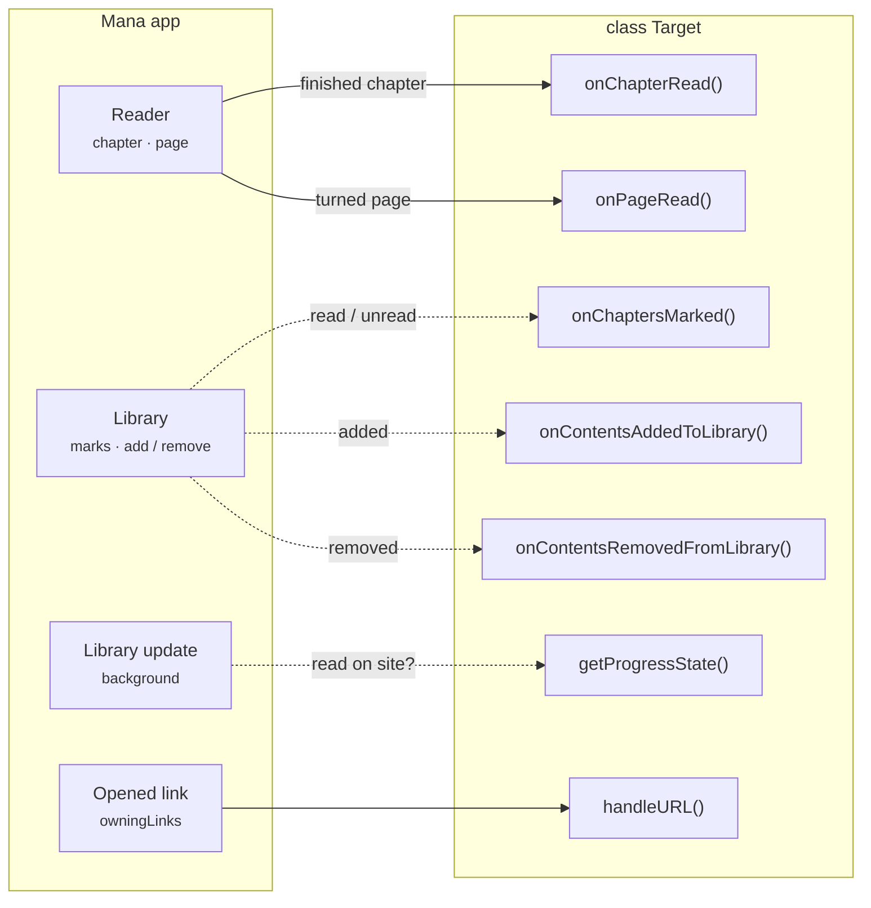
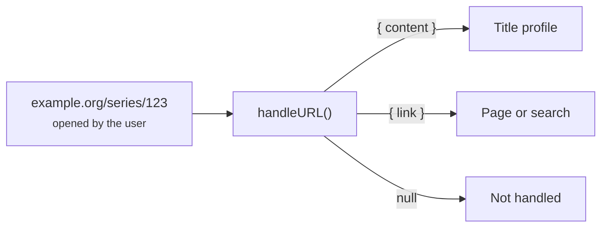

# Events and sync

Types: [ContentProgressState](data-model.md#contentprogressstate), [DeepLinkContext](data-model.md#deeplinkcontext)

These methods let a source mirror what the user does in Mana back to the site, and pull the site's state into Mana.



| Method | Mana today |
|---|---|
| `onChapterRead`, `onPageRead` | ✓ (needs `onChaptersMarked` too, see below) |
| `onChaptersMarked` | Required for chapter events, not called yet |
| `onContentsAddedToLibrary`, `onContentsRemovedFromLibrary` | Not called yet |
| `getProgressState` | Not called yet |
| `handleURL` | ✓ |
| `syncUserLibrary`, `getGroupedUpdates` | Not called yet |

## Reading events

Chapter events need both `onChaptersMarked` and `onChapterRead`; `onPageRead` is optional on top.

```ts
private lastPageSent = 0;

async onChapterRead(contentId: string, chapterId: string): Promise<void> {
  await this.http.post(`/api/history`, Body.json({ series: contentId, chapter: chapterId }));
}

async onPageRead(contentId: string, chapterId: string, page: number): Promise<void> {
  // Called on every page turn: send at most every 10 seconds.
  if (Date.now() - this.lastPageSent < 10_000) return;
  this.lastPageSent = Date.now();
  await this.http.post(`/api/progress`, Body.json({ series: contentId, chapter: chapterId, page }));
}

async onChaptersMarked(contentId: string, chapterIds: string[], completed: boolean): Promise<void> {
  await this.http.post(`/api/series/${contentId}/read`, Body.json({ chapters: chapterIds, read: completed }));
}
```

## Library events

> **Not called by Mana yet.** Both methods are needed.

```ts
async onContentsAddedToLibrary(ids: string[]): Promise<void> {
  await Promise.all(ids.map((id) => this.http.put(`/api/bookmarks/${id}`)));
}

async onContentsRemovedFromLibrary(ids: string[]): Promise<void> {
  await Promise.all(ids.map((id) => this.http.delete(`/api/bookmarks/${id}`)));
}
```

## Progress sync

> **Not called by Mana yet.** The method lets a source report which chapters the user already read on the site, so library updates could skip them.

```ts
import type { ContentProgressState } from "@mana-app/types";

async getProgressState(contentId: string): Promise<ContentProgressState> {
  const history = await (await this.http.get(`/api/series/${contentId}/history`)).requireOk().json<any>();

  return {
    readChapterIds: history.read.map(String),
    currentReadingState: history.current && {
      chapterId: String(history.current.chapter),
      page: history.current.page,
      progress: history.current.page / history.current.total,   // 0…1
      readDate: new Date(history.current.at),
    },
    markAllBelowAsRead: history.last && { chapterNumber: history.last.number, chapterVolume: history.last.volume },
  };
}
```

## Deep links

When the user opens a link on one of your `config.owningLinks` domains, Mana asks your source what it points to. Return `null` for links you don't handle.



```ts
import type { DeepLinkContext } from "@mana-app/types";

config = { owningLinks: ["example.org", "www.example.org"] };

async handleURL(url: string): Promise<DeepLinkContext | null> {
  const series = /\/series\/(\d+)/.exec(url);
  if (series) {
    const content = await this.getContent(series[1]);
    return { content: { id: series[1], title: content.title, cover: content.cover } };
  }

  const genre = /\/genre\/([\w-]+)/.exec(url);
  if (genre) {
    return { link: { title: genre[1], link: { request: { page: 1, filters: { genres: [genre[1]] } } } } };
  }

  return null;
}
```

If several sources claim a link, the user picks one.

## Library sync and grouped updates

> **Not called by Mana yet.**

```ts
// Merge the Mana library with the site's bookmarks; return what Mana should add.
async syncUserLibrary(library: UpSyncedContent[]): Promise<DownSyncedContent[]> {
  const known = new Set(library.map((c) => c.id));
  const bookmarks = await (await this.http.get("/api/bookmarks")).requireOk().json<any[]>();
  return bookmarks
    .filter((b) => !known.has(String(b.id)))
    .map((b) => ({ id: String(b.id), title: b.title, cover: b.cover }));
}

// One request for many titles' update counts since `date`.
async getGroupedUpdates(ids: string[], date: Date): Promise<GroupedUpdateResponse> {
  const json = await (await this.http.post("/api/updates", Body.json({ ids, since: date.toISOString() }))).requireOk().json<any>();
  return { updates: json.map((u: any) => ({ contentId: String(u.id), updateCount: u.new_chapters })) };
}
```
