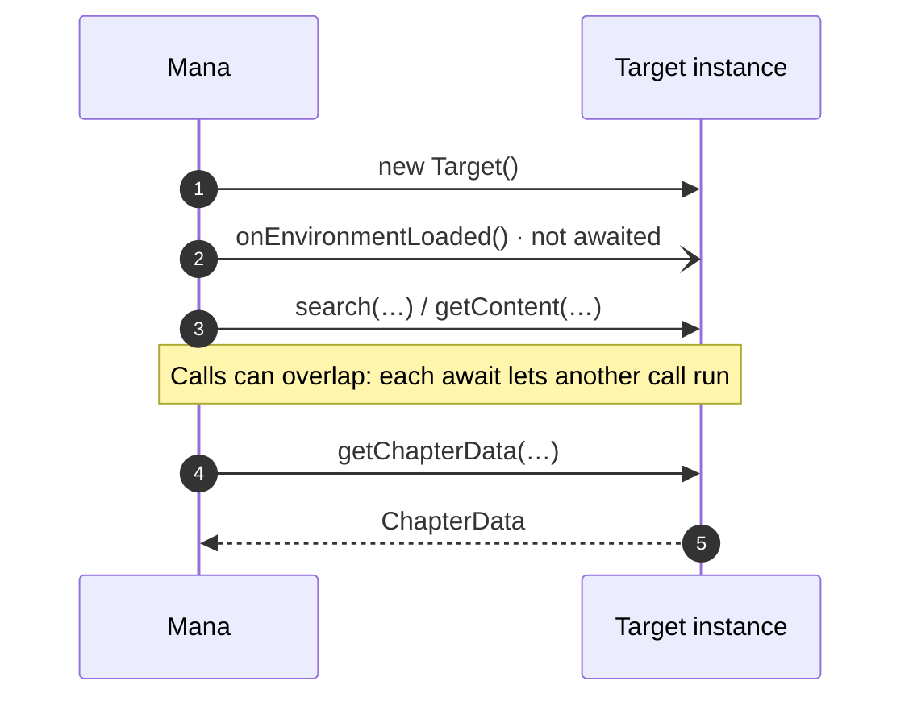

# Getting started

## Project layout

A source repository holds one folder per source. `mana-dev` bundles each folder into a `.mana` file and writes a `sources.json` index.

```
my-sources/
├── package.json          ← "mana": { "src": "src/", "out": "dist/", "target": "es2020" }
├── src/
│   └── Example/
│       ├── main.ts       ← declares `class Target`
│       ├── parsers.ts
│       └── client.ts
└── dist/
    ├── sources/Example.mana
    └── sources.json
```

```bash
npm install -D @mana-app/types
npm install -g @mana-app/dev
```

```bash
mana-dev serve --watch
```

`serve --watch` rebuilds on save and serves the repository over HTTP, so you can add it in Mana and see `console` output live. `mana-dev build` produces the files to publish.

## The `Target` class

The build looks for a class declaration named `Target`. Declare it directly, or extend a shared base class:

```ts
export class Target extends MadaraSource {}
```

```ts
export class Target implements ChapterSource, SearchProvider, SourcePreferenceProvider {
  readonly info = info;
  readonly config = config;
  // …
}
```

`implements` clauses only help TypeScript. What counts is which methods exist on the instance; see [Features are opt-in](overview.md#features-are-opt-in).

## `info`

```ts
import { CatalogRating, DefinedLanguages, type SourceInfo } from "@mana-app/types";

const info: SourceInfo = {
  id: "example",                       // unique and stable; changing it creates a new source
  name: "Example",
  version: "1.2.0",                    // bump to publish an update
  website: "https://example.org",      // required
  description: "Manga and webtoons from Example",
  rating: CatalogRating.MIXED,         // SAFE, MIXED or EXPLICIT
  supportedLanguages: [DefinedLanguages.ENGLISH, "fr_FR"],
  thumbnail: "Example.png",            // file in assets/, or an image URL
  developers: [{ name: "Jane", github: "https://github.com/jane" }],
  badges: ["Official"],
  minSupportedAppVersion: "1.4.0",
};
```

## `config`

```ts
import type { SourceConfig } from "@mana-app/types";

const config: SourceConfig = {
  disableUpdateChecks: false,                       // true skips library update checks
  cloudflareResolutionURL: "https://example.org",   // page opened to solve a challenge
  allowsMultipleInstances: false,                   // true lets users add it several times
  owningLinks: ["example.org", "www.example.org"],  // links that open in this source
  requiresAuthenticationToAccessContent: false,     // true when content needs sign-in
};
```

With `allowsMultipleInstances`, each instance gets its own `info.id`, settings and storage, so a self-hosted server source can point each instance at a different URL (see [setup](forms.md#first-run-setup)).

## Runtime

| You have | You don't have |
|---|---|
| ES2020+ JavaScript, `Promise`, `async`/`await`, typed arrays | DOM, `window`, `document` |
| `console`, timers, `AbortController` | `fetch`, `XMLHttpRequest`, `WebSocket` |
| `HttpClient` ([Networking](networking.md)) | `TextEncoder`, `TextDecoder`, `btoa` |
| `ObjectStore`, `SecureStore` ([Storage](storage.md)) | File system, `child_process`, other Node modules |
| `WebViewPage` ([WebView pages](webview.md)) | |
| `moment` (global, 2.30) | |
| Added by `mana-dev`: `Buffer`, `URL`, `URLSearchParams`, `atob`, `process.env`, `EventEmitter`, and the `buffer`, `events`, `path`, `util` modules | |

Bundle every library you use (cheerio, lodash, …); `mana-dev` does this for anything you import. Use `Buffer` for text and base64 conversions:

```ts
const text = Buffer.from(bytes).toString("utf8");      // Uint8Array → string
const decoded = Buffer.from(base64, "base64");          // base64 → bytes
const hex = Buffer.from(bytes).toString("hex");         // bytes → hex
```

## Lifecycle



`onEnvironmentLoaded` runs once, but Mana does not wait for it before the first call. Initialise lazily instead of relying on it:

```ts
private client?: HttpClient;

private get http(): HttpClient {
  this.client ??= buildClient();
  return this.client;
}

async onEnvironmentLoaded(): Promise<void> {
  // Good for warming caches or migrating stored data, not for required setup.
  await ObjectStore.remove("legacyCache");
}
```

## Concurrent calls

Mana can run several of your methods at once on the same instance (for example a library update while the user browses). Keep per-call state in local variables:

```ts
// ✗ Shared field: two searches overwrite each other's page.
private currentPage = 1;

// ✓ Local state.
async search(request: SearchRequest) {
  const page = request.page;
  // …
}
```

Guard shared state that changes across an `await`, such as a token refresh:

```ts
private refreshing?: Promise<string>;

private token(): Promise<string> {
  this.refreshing ??= this.refreshToken().finally(() => (this.refreshing = undefined));
  return this.refreshing;
}
```

## Errors and logging

Throw to show an error in Mana. The message is shown to the user, so make it readable.

```ts
if (!json.data) {
  throw new Error("This title was removed from Example.");
}
```

`console.log`, `info`, `warn`, `error` and `debug` go to Mana's log, tagged with your source ID. Objects are JSON-encoded.

```ts
console.log("search", { query: request.query, page: request.page });
```

Dates in returned objects are sent as ISO 8601 strings with the local offset.
