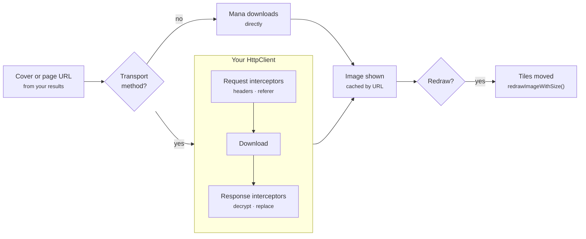
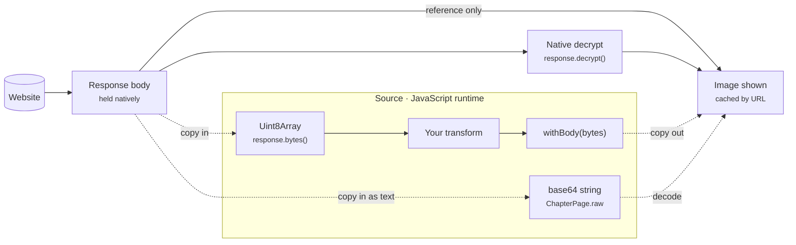
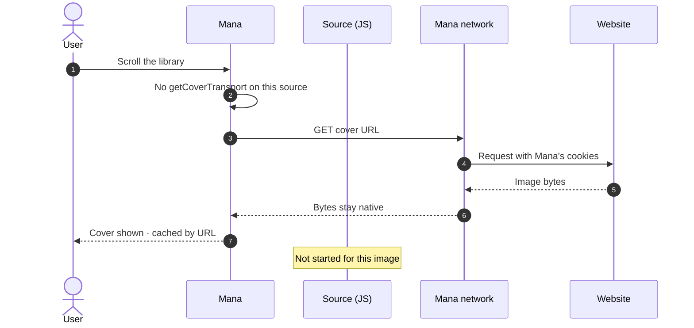
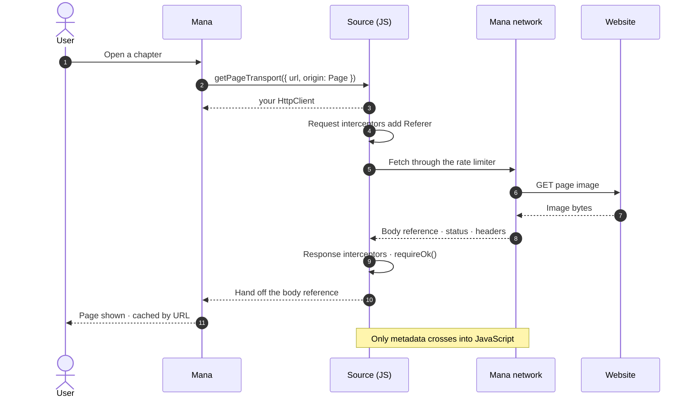
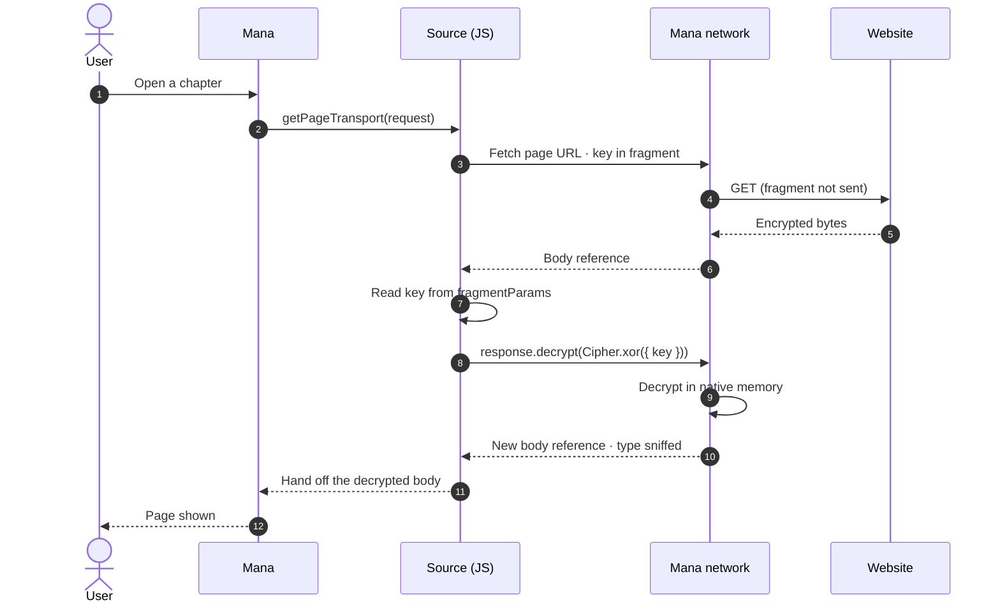
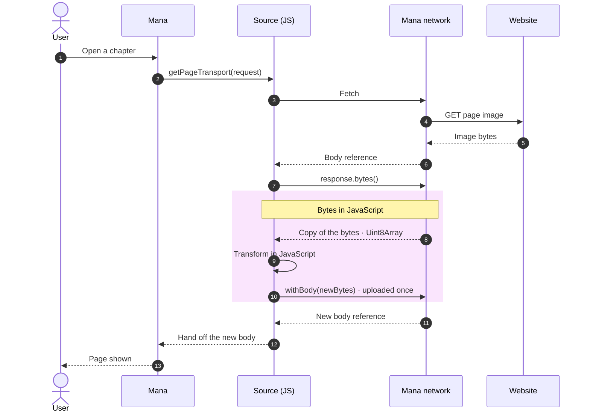
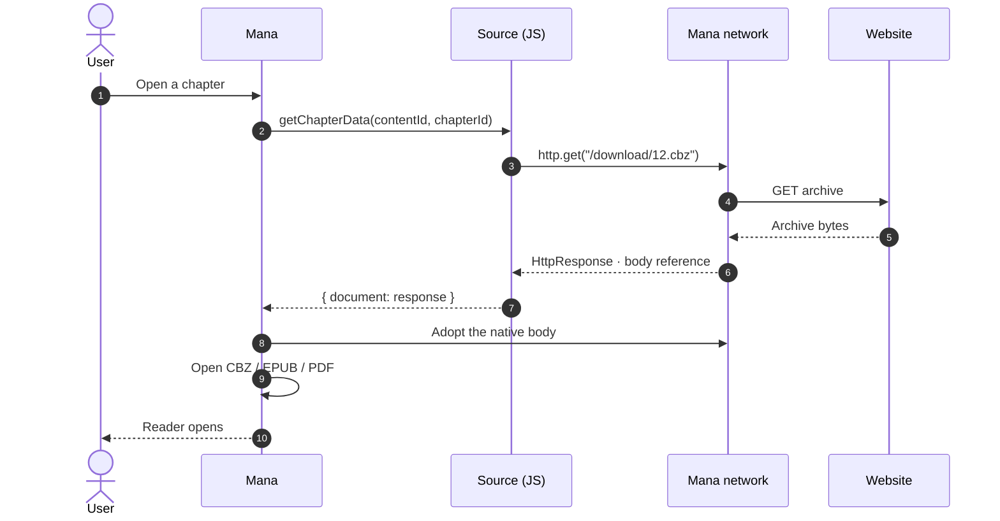
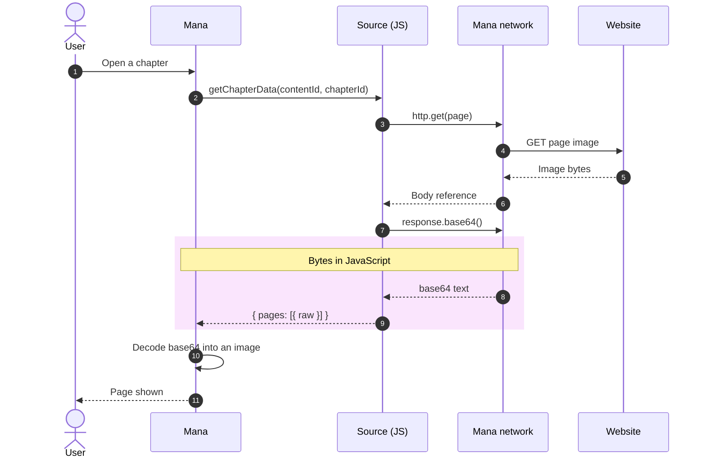
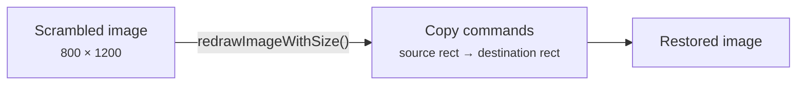

# Images

Types: [ImageRequest](data-model.md#networking), [RedrawWithSizeCommand](data-model.md#redraw)

By default Mana downloads cover and page URLs itself, without calling your source. Add a transport when images need headers, cookies, a rate limit or decryption.



## Transports

```ts
import { HttpClient, RequestOrigin, type ImageRequest } from "@mana-app/types";

private readonly http = new HttpClient()
  .setBaseURL("https://example.org")
  .setRateLimit(6, 1_000)
  .addRequestInterceptor((request, context) => {
    if (context.origin !== RequestOrigin.General) {
      request.headers.set("Referer", "https://example.org/");
    }
    return request;
  });

// Covers in search results, home rows and the library.
getCoverTransport(request: ImageRequest): HttpClient {
  return this.http;
}

// Reader pages and chapter downloads.
getPageTransport(request: ImageRequest): HttpClient {
  return this.http;
}
```

- Implement only the ones you need: a source whose covers load fine should skip `getCoverTransport` so covers never start your source.
- Return a long-lived client. A new client per call starts a fresh rate limiter each time.
- `request.url` and `request.origin` (`RequestOrigin.Cover` or `RequestOrigin.Page`) are available if you want separate clients.

```ts
private readonly cdn = new HttpClient().setRateLimit(20, 1_000);

getPageTransport(request: ImageRequest): HttpClient {
  return request.url.includes("cdn.example.org") ? this.cdn : this.http;
}
```

Images are cached by URL. If one URL can produce different images, put the distinguishing value in the URL (a query or [fragment](networking.md#fragment-parameters)).

## Decrypting or changing images

Use a response interceptor. Check `context.origin` so API responses are left alone.

```ts
import { Cipher, RequestOrigin } from "@mana-app/types";

this.http.addResponseInterceptor(async (response, context) => {
  if (context.origin !== RequestOrigin.Page) return response;

  // Key travels with the URL fragment from getChapterData (never sent to the server).
  const key = Buffer.from(response.request.fragmentParams.key, "hex");
  return response.decrypt(Cipher.xor({ key }));     // image type is detected
});
```

```ts
async getChapterData(contentId: string, chapterId: string): Promise<ChapterData> {
  const json = await (await this.http.get(`/api/chapter/${chapterId}`)).requireOk().json<any>();
  return { pages: json.pages.map((p: any) => ({ url: `${p.url}#key=${p.key}` })) };
}
```

To edit bytes yourself (slower, the image passes through JavaScript):

```ts
this.http.addResponseInterceptor(async (response, context) => {
  if (context.origin !== RequestOrigin.Page) return response;
  const bytes = await response.bytes();
  return response.withBody(stripHeader(bytes), { contentType: "image/webp" });
});
```

See [Crypto](crypto.md) for all ciphers.

## Where the bytes go

Image bytes normally stay in Mana's native memory: your source only handles a reference to the body. They are copied into the JavaScript runtime only when your code reads them (`bytes()`, `arrayBuffer()`, `base64()`, `text()`) or returns them (`withBody()`, `raw`).



| Case | Source runs? | Bytes enter JavaScript? | Cost |
|---|---|---|---|
| [No transport](#no-transport) | No | No | Cheapest |
| [Transport, headers only](#transport-with-headers) | Yes | No | One JavaScript call per image |
| [Native decryption](#native-decryption) | Yes | No | Decryption runs natively |
| [Reading bytes](#reading-and-replacing-bytes) | Yes | Yes, copied in and out | Two copies plus your JavaScript work |
| [Document](#documents) | Yes, once per chapter | No | One download, opened natively |
| [Inline `raw` pages](#inline-raw-pages) | Yes | Yes, as base64 text | Largest: text is about a third bigger than the image |

### No transport

The source has no `getCoverTransport` / `getPageTransport`, so Mana loads the URL itself and your JavaScript never starts for images.



### Transport with headers

A request interceptor adds headers; the image comes back as a reference and is handed straight to Mana. Chapter downloads take the same path.



### Native decryption

`response.decrypt(cipher)` asks Mana to decrypt the body where it is held. JavaScript only sends the cipher spec.



### Reading and replacing bytes

Calling `response.bytes()` copies the image into JavaScript (a `Uint8Array`; base64 text under WebKit). Returning `withBody(newBytes)` copies the result back once. Use this only when no [native cipher](crypto.md) fits.



### Documents

A CBZ, EPUB, PDF or text file returned as `ChapterData.document` is handed to Mana as a native body when `getChapterData` finishes.



### Inline raw pages

Pages returned as `raw` base64 strings pass through JavaScript as text and are decoded by Mana. Prefer `url` with a transport where you can.



## Descrambling tiles

For sites that cut pages into shuffled tiles. Both methods are required.



```ts
import type { BooleanState, CGSize, RedrawWithSizeCommand } from "@mana-app/types";

async shouldRedrawImage(url: string): Promise<BooleanState> {
  return { state: url.includes("/scrambled/") };
}

async redrawImageWithSize(size: CGSize): Promise<RedrawWithSizeCommand> {
  const columns = 4;
  const rows = 4;
  const w = Math.floor(size.width / columns);
  const h = Math.floor(size.height / rows);
  const order = [5, 2, 9, 0, 14, 7, 1, 12, 3, 10, 6, 15, 8, 13, 4, 11]; // site's tile order

  return {
    size,
    commands: order.map((from, to) => ({
      source: { origin: { x: (from % columns) * w, y: Math.floor(from / columns) * h }, size: { width: w, height: h } },
      destination: { origin: { x: (to % columns) * w, y: Math.floor(to / columns) * h }, size: { width: w, height: h } },
    })),
  };
}
```

`redrawImageWithSize` only receives the image size, so the tile order must not depend on the URL. If it does, decrypt or rearrange in a [response interceptor](#decrypting-or-changing-images) instead.
