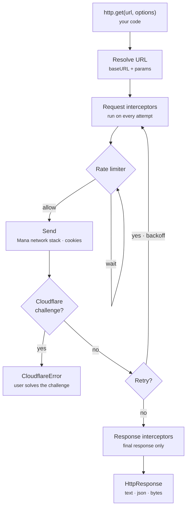

# Networking

Types: [HttpClient types](data-model.md#networking)

`HttpClient` from `@mana-app/types` is the only way to make requests. It shares Mana's cookies and user agent, handles Cloudflare, and its requests are cancelled when Mana cancels the method that started them.



Request interceptors run again on every attempt; response interceptors run once, on the final response.

## Creating a client

Create one client per source and reuse it everywhere, so the rate limit covers every request.

```ts
import { HttpClient, RateLimit } from "@mana-app/types";

private readonly http = new HttpClient()
  .setBaseURL("https://api.example.org/v2")      // no query or fragment
  .setTimeoutMs(20_000)                           // default 30 000
  .setRetry(2)                                    // default 0
  .addHeader("Referer", "https://example.org/")
  .addHeaders({ Accept: "application/json", "X-Client": "mana" })
  .setRateLimiter(RateLimit.spaced({ requests: 5, intervalMs: 1_000 }));
```

`removeHeader(name)` drops a default header again.

## Requests

```ts
import { Body, HttpMethod } from "@mana-app/types";

// GET with query parameters: /search?q=solo&page=2&genre=action&genre=drama
const response = await this.http.get("/search", { params: { q: "solo", page: 2, genre: ["action", "drama"] } });

// Absolute URLs ignore the base URL.
await this.http.get("https://cdn.example.org/manifest.json");

await this.http.head("/chapter/1");
await this.http.delete("/library/123");

// Bodies
await this.http.post("/login", Body.json({ user: "jane", password: "…" }));
await this.http.post("/search", Body.form({ action: "search", term: "solo" }));
await this.http.put("/note", Body.text("hello", "text/plain; charset=utf-8"));
await this.http.patch("/avatar", Body.bytes(pngBytes, "image/png"));

// Any method
await this.http.request({ url: "/graphql", method: HttpMethod.Post, body: Body.json({ query }) });
```

### Per-request options

```ts
import { OutcomeKind } from "@mana-app/types";

const controller = new AbortController();

await this.http.get("/slow", {
  headers: { Authorization: `Bearer ${token}` },
  params: { page: 1 },
  timeoutMs: 60_000,
  retry: { maxRetries: 3, shouldRetry: ({ outcome }) => outcome.kind === OutcomeKind.Error },
  signal: controller.signal,
  metadata: { kind: "chapterList" },              // read back in interceptors
});
```

### Fragment parameters

A URL fragment is never sent. Its `key=value` pairs stay on the request as `fragmentParams`, which is handy for carrying per-image secrets from `getChapterData` to an image interceptor:

```ts
// getChapterData
return { pages: images.map((img) => ({ url: `${img.url}#key=${img.key}` })) };

// interceptor
const key = response.request.fragmentParams.key;
```

## Responses

```ts
const response = await this.http.get("/api/series/1");

response.status;                 // 200
response.ok;                     // true for 2xx
response.url;                    // final URL after redirects
response.headers.get("content-type");
response.headers.location;       // lowercase property access works too
response.request.url;

const text = await response.text();
const json = await response.json<{ title: string }>();
const bytes = await response.bytes();            // Uint8Array
const buffer = await response.arrayBuffer();
const b64 = await response.base64();

response.requireOk();            // throws HttpStatusError unless 2xx, returns the response
```

```ts
// Typical one-liner
const series = await (await this.http.get(`/series/${id}`)).requireOk().json<Series>();
```

Read bodies before your method returns. After that the response can no longer be read; values you already parsed stay valid.

Make a modified copy with `withBody`, or decrypt one with [`decrypt`](crypto.md):

```ts
const patched = response.withBody(fixedHtml, { contentType: "text/html" });
```

## Interceptors

Interceptors run on every request of the client, including [image requests](images.md).

```ts
import { RequestOrigin } from "@mana-app/types";

this.http
  // Sign every request.
  .addRequestInterceptor(async (request, context) => {
    const token = await SecureStore.string("token");
    if (token) request.headers.set("Authorization", `Bearer ${token}`);
    if (context.origin === RequestOrigin.Page) request.headers.set("Referer", "https://example.org/reader");
    return request;
  })
  // Fix a broken redirect header.
  .addResponseInterceptor((response) => {
    const location = response.headers.location;
    if (location) response.headers.location = location.replace(/^http:/, "https:");
    return response;
  });
```

| `context` field | Meaning |
|---|---|
| `origin` | `RequestOrigin.General`, `Cover` or `Page` |
| `attempt` | 1 for the first try, then 2, 3 … on retries |
| `requestId` | Unique per request |
| `metadata` | What you passed in `options.metadata` |

Remove one later with `removeRequestInterceptor(fn)` / `removeResponseInterceptor(fn)`.

## Rate limiting

```ts
// At most 5 requests per second, evenly spaced.
.setRateLimit(5, 1_000)
.setRateLimiter(RateLimit.spaced({ requests: 5, intervalMs: 1_000 }))

// Bursts of up to 10, refilling 2 per second.
.setRateLimiter(RateLimit.tokenBucket({ capacity: 10, refillTokens: 2, intervalMs: 1_000 }))

// Custom: space image requests 250 ms apart, but let API calls through freely.
.setRateLimiter(imageThrottle(250))
```

```ts
import { OutcomeKind, RateLimitAction, RequestOrigin, type RateLimiter } from "@mana-app/types";

function imageThrottle(spacingMs: number): RateLimiter {
  let next = 0;
  return {
    tryAcquire(context) {
      if (context.origin === RequestOrigin.General) return { action: RateLimitAction.Allow };
      if (context.nowMs < next) return { action: RateLimitAction.Wait, retryAfterMs: next - context.nowMs };
      next = context.nowMs + spacingMs;
      return { action: RateLimitAction.Allow };
    },
    onComplete(context, outcome) {
      // Optional: back off after a 429.
      if (outcome.kind === OutcomeKind.Response && outcome.status === 429) next = context.nowMs + 5_000;
    },
  };
}
```

Retries and image requests go through the same limiter.

## Retries

`setRetry(n)` or `options.retry` set the number of retries. By default Mana retries only `GET` and `HEAD`, on network errors (not timeouts or cancellation) and on 429, 502, 503 and 504. It waits for `Retry-After` when present, otherwise 250 ms, 500 ms, 1 s … up to 5 s.

```ts
// Refresh an expired token and retry once. `shouldRetry` is synchronous, so it
// starts the refresh and the request interceptor waits for it on the retry.
.setRetry({
  maxRetries: 1,
  shouldRetry: ({ outcome }) => {
    if (outcome.kind !== OutcomeKind.Response || outcome.status !== 401) return false;
    this.refreshing ??= this.refreshToken().finally(() => (this.refreshing = undefined));
    return true;
  },
})
.addRequestInterceptor(async (request) => {
  await this.refreshing;
  request.headers.set("Authorization", `Bearer ${await SecureStore.string("token")}`);
  return request;
})

// Retry POSTs too, and also on 500.
.setRetry({
  maxRetries: 2,
  shouldRetry: ({ request, outcome, retriesUsed }) =>
    outcome.kind === OutcomeKind.Response
      ? [500, 502, 503, 504].includes(outcome.status)
      : !(outcome.error instanceof TimeoutError),
})
```

## Errors

```ts
import { AbortError, CloudflareError, HttpStatusError, NetworkError, TimeoutError } from "@mana-app/types";

try {
  return await (await this.http.get(`/series/${id}`)).requireOk().json();
} catch (error) {
  if (error instanceof HttpStatusError && error.response.status === 404) {
    throw new Error("This title no longer exists on Example.");
  }
  throw error;   // let CloudflareError, TimeoutError, … through
}
```

| Error | When |
|---|---|
| `NetworkError` | Connection failed. Has `request`. |
| `TimeoutError` | `timeoutMs` passed (subclass of `NetworkError`). |
| `AbortError` | Cancelled by your `signal` or by Mana (subclass of `NetworkError`). |
| `HttpStatusError` | `requireOk()` on a non-2xx response. Has `response`. |
| `CloudflareError` | Cloudflare challenge detected. Has `resolutionURL`. |

### Cloudflare

You don't need to detect challenges yourself. When one appears, the request throws `CloudflareError`; let it propagate and Mana offers the user a page to solve it (at `config.cloudflareResolutionURL`, or `info.website`).

```ts
// Throw it yourself for a custom block page.
if ($("title").text() === "Just a moment...") throw new CloudflareError("https://example.org");
```
