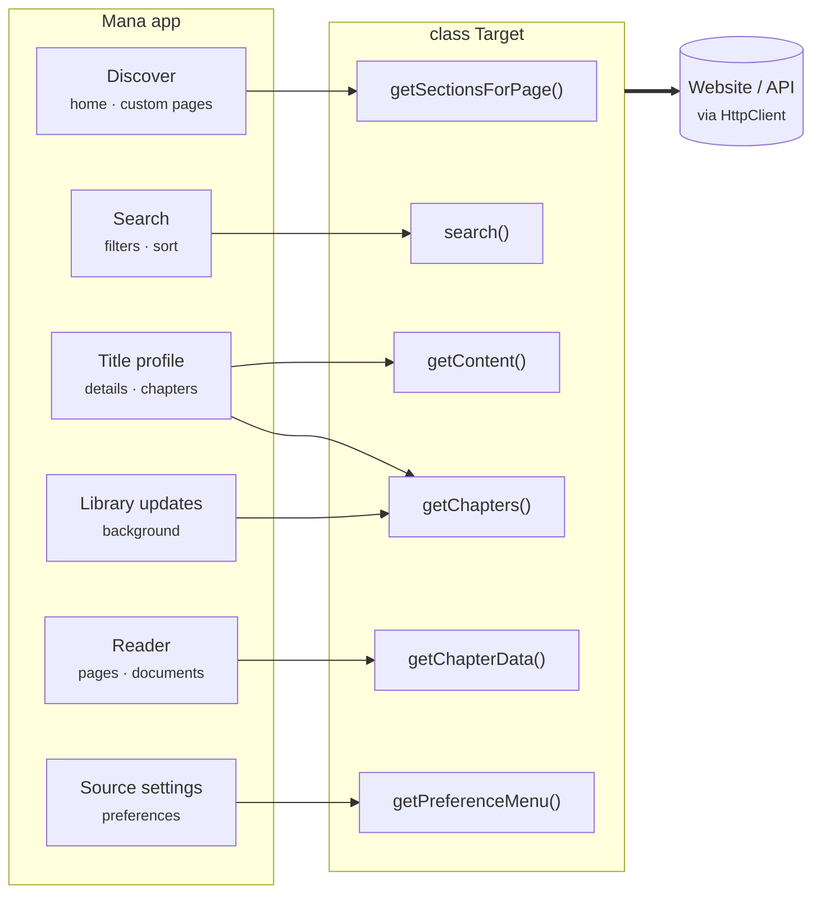

# Building sources

A source is a small TypeScript project that Mana loads to browse, search and read from one website. Types come from [`@mana-app/types`](https://github.com/Mana-iOS/mana-types); sources are built with [`mana-dev`](https://www.npmjs.com/package/@mana-app/dev). Start with [Getting started](getting-started.md).

## How Mana talks to a source

Mana creates one instance of your `Target` class and calls its methods when the user does something. Every method is `async` and returns plain JSON-compatible objects.



## Features are opt-in

Mana only offers a feature when your class has the methods behind it. The build detects them, so rebuild after adding or removing a method. Some features need a pair of methods. A few methods are not called by Mana yet; see [API status](status.md).

| Feature | Methods |
|---|---|
| Title pages (required) | `getContent`, `getChapterData`, plus `getChapters` unless `Content.chapters` is filled |
| Search | `search`; optional `getSearchForm`, `getSortOptions`, `validateSearchForm` |
| Custom home page | `getSectionsForPage` **and** `resolvePageSection` |
| Library links | `getLibraryPageLinks` |
| Settings | `getPreferenceMenu` |
| First-run setup | `getSetupMenu` **and** `validateSetupForm` **and** `isSourceSetup` |
| Sign-in | `getAuthenticatedUser` **and** `handleUserSignOut`, plus one sign-in style |
| Chapter events | `onChaptersMarked` **and** `onChapterRead`; optional `onPageRead` |
| Library events | `onContentsAddedToLibrary` **and** `onContentsRemovedFromLibrary` |
| Progress sync | `getProgressState` |
| Deep links | `handleURL` with `config.owningLinks` |
| Custom image loading | `getCoverTransport`, `getPageTransport` |
| Tile descrambling | `shouldRedrawImage` **and** `redrawImageWithSize` |
| Tracker | `getContent`, `search`, `didUpdateLastReadChapter`, `didUpdateStatus`, `getEntryForm`, `didSubmitEntryForm` (see [Trackers](trackers.md)) |

## Smallest useful source

```ts
import { load } from "cheerio";
import {
  HttpClient,
  RateLimit,
  type Chapter,
  type ChapterData,
  type ChapterSource,
  type Content,
  type PagedSearchResult,
  type SearchRequest,
  type SourceInfo,
} from "@mana-app/types";

const BASE = "https://example.org";

export class Target implements ChapterSource {
  readonly info: SourceInfo = {
    id: "example",
    name: "Example",
    version: "1.0.0",
    website: BASE,
    supportedLanguages: ["en_US"],
  };

  private readonly http = new HttpClient()
    .setBaseURL(BASE)
    .setRateLimit(3, 1_000);

  async search(request: SearchRequest): Promise<PagedSearchResult> {
    const $ = load(await (await this.http.get("/search", {
      params: { q: request.query ?? "", page: request.page },
    })).requireOk().text());

    const results = $(".item").map((_, el) => ({
      id: $(el).attr("data-id")!,
      title: $(el).find(".title").text().trim(),
      cover: $(el).find("img").attr("src")!,
    })).get();

    return { results, isLastPage: $(".next").length === 0 };
  }

  async getContent(contentId: string): Promise<Content> {
    const $ = load(await (await this.http.get(`/series/${contentId}`)).requireOk().text());
    return {
      title: $("h1").text().trim(),
      cover: $(".cover img").attr("src")!,
      summary: $(".summary").text().trim(),
      webUrl: `${BASE}/series/${contentId}`,
    };
  }

  async getChapters(contentId: string): Promise<Chapter[]> {
    const $ = load(await (await this.http.get(`/series/${contentId}`)).requireOk().text());
    const rows = $(".chapter").get();
    return rows.map((el, i) => ({
      chapterId: $(el).attr("data-id")!,
      number: Number($(el).attr("data-number")),
      index: rows.length - 1 - i,           // newest first on the page, oldest = 0
      date: new Date($(el).find("time").attr("datetime")!),
      language: "en_US",
    }));
  }

  async getChapterData(contentId: string, chapterId: string): Promise<ChapterData> {
    const $ = load(await (await this.http.get(`/read/${chapterId}`)).requireOk().text());
    return { pages: $(".page img").map((_, img) => ({ url: $(img).attr("src")! })).get() };
  }
}
```
